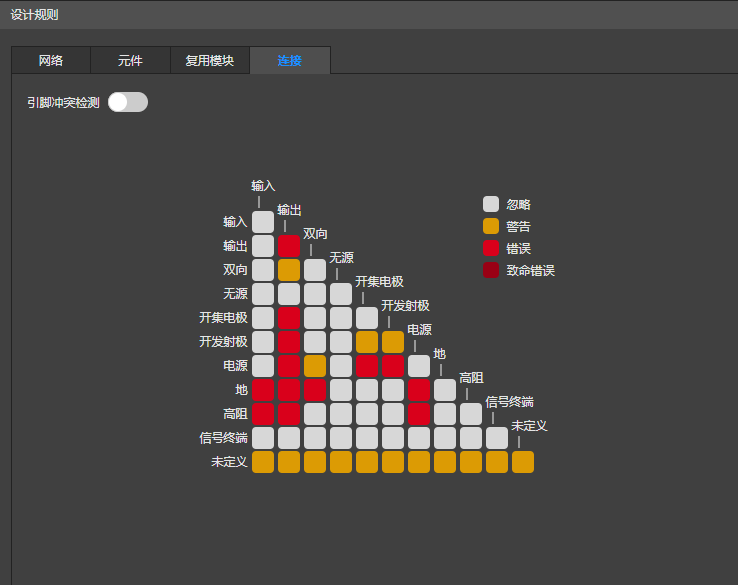
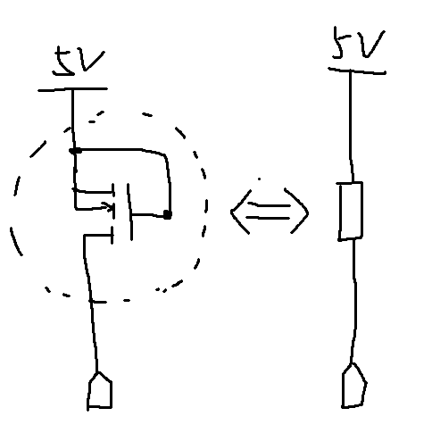

## 引脚的电气特性

双向pin可以输入/输出信号, 比如I2C的SDA引脚.

### I2C

属于off-chip(片外)协议. 是飞利浦公司让板子上**不同芯片**互相通信而发明的...

对比片内(on-chip)协议(AMBA), 它是芯片内模块通信. 距离极短, 速度极快, **不需要外部上拉电阻**.

两根线, 开漏出, 上拉撑, 线与逻辑.

SCL 时钟线 电气特性为clk.
SDA 数据线 电气特性为双向.

## 上拉电阻

VCC(BJT时代老名词), VDD(MOS时代新名词)都指正电源.

上拉电阻, 就是 连接**某个引脚**和**正电源**的电阻. 

**正电源+上拉电阻**, 可以: 当这个引脚没有任何驱动时, 保持在高电平. (没有上拉电阻的话这个引脚就只能是高电平, 不能尝试输出低电平(会短路)了, 就没意义了)

片内设计中, 为了节省面积, 不会画一个物理的电阻, 而是用**G极和D极短接的PMOS**(或PNP)代替上拉电阻.

原理: 这样连接后, 分析:
初始状态: 端口电压为0V, 

同理也会用**G极和S极短接的NMOS**(或NPN)代替下拉电阻.

## 下拉电阻

