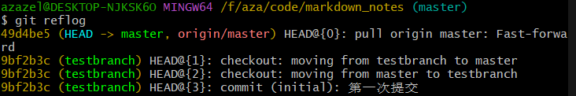

<!-- review-toc:start -->
<details>
<summary>复习目录（点击展开）</summary>

- [1 如何初始化一个git仓库](#1-如何初始化一个git仓库)
- [2 git的三个区: HEAD, index, working tree, 以及文件的属性状态机](#2-git的三个区-head-index-working-tree-以及文件的属性状态机)
- [3 git checkout](#3-git-checkout)
- [4 查看日志 git log & git reflog](#4-查看日志-git-log--git-reflog)
- [5 git ignore](#5-git-ignore)
- [6 常用命令](#6-常用命令)
- [7 回档 git reset](#7-回档-git-reset)
- [8 branch管理](#8-branch管理)
- [9 从网上 clone 仓库](#9-从网上-clone-仓库)
- [10 远程仓库](#10-远程仓库)
- [11 网络问题和ssh](#11-网络问题和ssh)
- [12 Git 项目开发规范](#12-git-项目开发规范)

</details>
<!-- review-toc:end -->

配套：[Linux 与工具链笔记](Linux笔记.md)

# Git 工具教程

## 1 如何初始化一个git仓库

* 将一个文件夹myfile初始化为仓库并导入azazelplus账号的git在线仓库：
首先在在该目录下运行git bash.
```bash
git init  #初始化仓库, 生成.git目录.

#如果还没有设定身份,需要先设定身份(我的github.com网站的用户名和邮箱.)
git config user.name "azazelplus"
git config user.email "azazelplusplusplus@gmail.com"


git add . #将目录下所有文件放入暂存区, 等待commit.

git commit -m "first commit"  #第一次提交到本地仓库.

#commit成功运行时, 会显示create mode xxxxx (yourFileName)

git log #查看一下提交日志, 应该是只有一条刚刚的第一次提交.

git remote add origin <url>
#git remote add命令用于为 当前本地git仓库 添加一个名为origin的新的远程仓库. (惯例取名origin) 
#远程仓库的url可以使用http协议, 也可以使用ssh协议. 要先在github.com中新建一个仓库, 然后复制新仓库的url, 粘贴在这里.
#在github.com创建远程仓库时取的别名可能和这里的名字不同, 这没有影响, 在git bash中继续使用惯例origin来引用这个仓库.
#不同的本地仓库完全可以都这么干, 都叫origin是允许的, git是以一个仓库为单位管理的, 不会混淆.

git push -u origin master #将本地仓库的分支`master`推送到
# -u选项会设定远程仓库`origin`为本地仓库分支`master`的该本地仓库将会和该远程仓库默认绑定, 默认push和pull的时候就是他俩之间的交互.

#到此成功创建本地仓库, 并创建对应远程仓库.
```

* 每次修改完本地文件, 存档到本地仓库和远程仓库:
```bash
git add . #把所有文件放到暂存区

git commit -m "i did something-2024-08-15"  #提交快照到本地仓库

git push  #将本地提交推送到 本地仓库所默认的 远程仓库.
# 即可完成一次存档.
```


## 2 git的三个区: HEAD, index, working tree, 以及文件的属性状态机

对一个git仓库,  其所有文件有两个属性:
* tracked
* untracked

一个tracked的文件, 在git的三个区各有一份拷贝.(其中HEAD是通过指针实现的, 不是完整的数据拷贝, 不过效果一样, 节省空间.) 通过比对这些拷贝的异同, tracked的文件得到了不同的属性.

### 2.1 HEAD

在执行`git commit`时, 文件`foo`在HEAD内的拷贝被同步为tracked文件`foo`在index的拷贝.


实现上, 文件内容存为 blob, 目录快照由 tree 记录；commit 引用 tree, 同时记录父提交、作者和提交说明等信息.


一个git本地仓库维护一个全局的HEAD指针. 它指向"**你现在在哪个分支的哪个提交**"

**每个分支维护自己的指针**, 用来记录该分支的最新commit.

* 一般情况下, 它指向当前branch(比如master), 然后**当前分支再指向其最新的commit**.
  
#### 2.1.1 detached HEAD模式
* **detached HEAD** 模式下, HEAD指向一个具体的commit.

### 2.2 index(暂存区, staged area)

执行`git add`命令, 会将对应tracked文件在working tree的拷贝同步到它在index的拷贝.


### 2.3 working tree

就是磁盘上的数据.

### 2.4 文件的**tracking status状态机**

git仓库中, 所有文件有`track属性`, 分为`tracked`和`untracked`. 对文件运行`git add`, `git rm --cached`命令, 会改变这个属性.
* tracked: 在index区有副本. 而`tracked`的文件, git通过比较三个快照(HEAD, index, workingtree), 使它们拥有属性:
  * 通过区分index和HEAD是否相同:
    * **staged(index dirty)**: 当index ≠ HEAD
      * 这意味着`foo`的暂存区应当用`git commit`被推送到仓库里.
    * **not staged(index clean)**: 当index = HEAD
      * 这意味着`foo`的暂存区已经和仓库里一样了, 不需要被推送.
      * 注意! 这不是**unstaged**!
  * 通过区分index和working tree是否相同:
    * **unstaged changes(working tree dirty)**: 当index ≠ working tree
      * 这意味着`foo`在本地修改过, 应当用`git add`推送到暂存区.
    * **no unstaged change(working tree clean)**: 当index = working tree
      * 这意味着`foo`在本地和暂存区一致, 不需要`git add`.
  * 上述两对属性结合, 给用户显示的常用属性:
    * **modified**: 其中有一个dirty了. git status会分开显示.
    * **unmodified**: 文件`foo`的三个副本相同: `HEAD` = `index` = `working tree`.
* untracked: 在index区无副本.


直接来看例子. 使用`git status`查看当前仓库状态:

```
azazel@DESKTOP-NJKSK6O:~/ysyx-workbench$ git status
On branch pa2
Your branch is ahead of 'origin/pa2' by 1 commit.
  (use "git push" to publish your local commits)

Changes to be committed:
  (use "git restore --staged <file>..." to unstage)
        modified:   .gitignore
        modified:   nemu/.gitignore
        new file:   nemu/src/device/readme.md
        new file:   nemu/src/memory/readme.md
        new file:   nemu/src/monitor/sdb/readme.md
        new file:   nemu/src/readme.md
        new file:   nemu/src/utils/readme.md

Changes not staged for commit:
  (use "git add <file>..." to update what will be committed)
  (use "git restore <file>..." to discard changes in working directory)
        modified:   .gitignore

```

分析一下上面的内容. 首先分为两块:
* **Changes to be committed**: 这是比较HEAD和index区的结果. 列出的modified(new file也是一种特殊的modified啦), 意为该文件在HEAD的副本和index的副本不同. 执行`git commit`会消除它们.
* **Changes not staged for commit**:这是比较index和working tree的结果. 列出的modified, 意为该文件在index的副本和working tree的副本不同. 执行`git add`会消除它们.

* 使用--ignored选项, 会额外列出当前仓库ignored掉的文件. 现场跑一边ignore引擎.


* `git rm -f <file>` 将文件从本地和index全部删掉. 这是删除文件, 同时希望一步到位清理git留存的方式.
* `git rm --cached <file>` 只将文件从index区删掉, 保留工作目录的文件. 这是保留文件, 但希望git不再跟踪该文件的方式.


## 3 git checkout

`checkout` 可以切换分支、检出历史提交或恢复文件；是否改动工作区取决于使用方式.

```bash
git checkout branch_name #切换分支, HEAD 通常附着在分支上；不进入 detached HEAD.


git checkout <commit_hash>  #把当前本地仓库的当前branch切换到指定历史commit. HEAD指针变为detached模式.

git checkout -- filename  #把当前本地仓库工作目录的某个文件恢复到[暂存区]的样子, 丢弃你在工作区的修改. 例如: 上一次commit后, 想改一个文件, 改来改去不想改了(期间没有git add), 想恢复到上一次commit的内容.

```

## 4 查看日志 git log & git reflog

### 4.1 git log

这个命令列出**当前本地分支的commit记录**.

```bash
git log #显示当前仓库所有提交历史

git log -n 3 #显示最近的三次提交.

git log -n 3 --oneline #--oneline选项将每个提交略缩为一行简洁信息显示.

git log --since="2 weeks ago" #显示过去两周内的提交记录.

git log <filename> #只显示文件夹中某个文件的提交历史.


git log | less  #分页查看日志, 可用Page Up/Page Down查看大量信息.

git log <branch-name> #显示某个分支的所有提交.

git log --author="name" #过滤掉某个作者的提交显示.

git log --grep="bug fix"  #提交信息过滤, 过滤出包含"bug fix"的更新日志.
```

### 4.2 git reflog

这个指令显示在当前本地仓库中**对`HEAD`(当前分支的指针)所做的操作记录**.
这些记录仅存在于本地仓库, 不会被推送到远程仓库.

当你执行这些操作的时候, HEAD指针会变化:
* git commit
  * 新建一个commit节点, HEAD移动到新commit.
* git checkout <branch_name>
  * HEAD指向
* git reset
* git merge
* git rebase
* git pull

从而记录在git reflog中.


这些输出的意思:
```git
49d4be5 (HEAD -> master, origin/master) HEAD@{0}: pull origin master: Fast-forward
```
>`49d4be5`: 这是一个提交 ID，标识了当前 `HEAD` 指向的提交，也就是 git pull 操作后指向的提交。

>`HEAD -> master`: 表示当前 HEAD 指向的是 `master` 分支。

>`origin/master`: 本地远程跟踪引用当前也指向它；反映最近一次获取到的远端状态, 不保证远端此刻没有新提交.

>`HEAD@{0}`: 表示这是你最近的一次操作，索引值为 `0`。

>`pull origin master: Fast-forward`: 说明最近的一次操作是 `git pull`，并且通过 “Fast-forward” 模式合并了远程 `master` 分支的更改到本地 `master` 分支。

```git
9bf2b3c (testbranch) HEAD@{1}: checkout: moving from testbranch to master
```
>这是倒数第二次操作, 操作为`checkout`,将分支从`testbranch`切换到了`master`.


## 5 git ignore

### 5.1 .gitignore白名单项目管理模板
对一个仓库, 其主.gitignore和每个子文件夹, 最好都使用这样的白名单:

```gitignore
# .gitignore语法规则:
# 请查看文档https://git-scm.com/docs/gitignore
# foo   # 普通模式. 递归匹配任意层级下的文件foo.
# *     # 匹配当前目录任意字符, 但是不包括路径分隔符/, 不递归. 例如, src/*.c会匹配src/main.c, 但不会匹配src/lib/helper.c 
# **    # 全局通配符. 匹配一切.
# ?     # 匹配任意单个字符
# /     # 路径锚定. `/`被允许出现在gitignore模式的开头, 中间, 结尾.
# 如果模式开头或中间（或两者兼有）存在分隔符(如`/npc2`)，则该模式相对于特定 .gitignore 文件所在的目录级别。否则，该模式也可能匹配 .gitignore 文件级别以下的任何级别。
# 如果模式末尾有分隔符(如`npc2/`)，则该模式将仅匹配目录；否则，该模式可以同时匹配文件和目录。


# !     # 反忽略. 如果父目录已经被忽略, 则无效.


# 一个项目的所有目录的.gitignore都应该用下面的白名单格式配置.gitignore:
# *
# !*/

# !/allowed_dir/
# !/allowed_file


# 主ignore默认忽略一切文件, 由子ignore用白名单决定追踪哪些文件.
*
# 允许进入所有文件夹进行探测
!*/ 

# 要追踪的目录
!/nemu/
!/abstract-machine/
!/nanos-lite/
!/navy-apps/
!/npc/
!/npc2/
!/test/
!/test/ldtest/

# 要追踪的顶层文件
!.gitignore
!Makefile
!README.md
!init.sh
```

### 5.2 git check-ignore命令

对给定路径, 运行git的ignore引擎规则. 

* 输出**最终生效的那一条匹配规则.**
    ```bash
    <规则来源文件>:<行号>:<规则文本> <路径>
    ```
* 返回值: `0`(至少有一条匹配规则匹配了该路径),` 1`(没有匹配规则匹配该路径)


**如果给定路径已经被tracked**, 由于ignore匹配引擎只对untracked文件生效, 此时不会有任何输出, 返回值为`1`.

使用`--no-index`选项, 可以让ignore引擎忽略文件的tracked状态, 强制运行ignore规则匹配.


注意: 它给出的结果不代表你`git add .` 真的能把这个文件放到index区, 除非你能保证:
* **该文件的所有父目录都没有被ignore规则忽略掉**.
* **对该文件运行check-ignore,返回为空或者返回为一个`!`开头的反忽略规则.**

这是因为git的ignore引擎并不是一个简单的f(path), 而是一个f(traversal_state, path).


<details>
<summary>当时的调试记录（保留原文）</summary>

```
我已经完全明白. 现在我的结论是林纳斯应该被我开车撞死, 这个git check-ignore她妈的除了浪费我一整个下午之外没有任何实际工程意义, 程序员需要的东西是`git rm --cache .  && git add . `的run dry结果. 林纳斯应该被开车撞死. 这种愚蠢的现实是怎麽存在在2026年还没人报警的???
```

</details>


### 5.3 文件的**忽略逻辑状态机**

下面是我用来理解忽略规则的概念模型, 不是 Git 对外保证的内部数据结构：
```C
enum ignore_state {
    UNDECIDED,
    IGNORED,
    NOT_IGNORED
};
```

* **忽略逻辑状态机**和文件实际index状态的状态机无关. 运行`git add --force foo`把`foo`强制放入index(即使它按照现在的规则应当被忽略)并不会改变`foo`的忽略逻辑状态.

* 发生查询该忽略逻辑状态机时, 状态转移规则是:
  * 对git仓库里某个文件`foo`, git设置其初始状态为`UNDECIDED`, 然后**按照顺序**读取`foo`所在的各层目录的.gitignore指令.
    * 如果`foo`的父目录被.gitignore忽略, 那麽`foo`的状态机变成`IGNORED`, 停止.
    * 如果`foo`被一条命令忽略规则匹配, 那麽`foo`的状态机变成`IGNORED`.
    * 如果`foo`在`IGNORED`状态下又被一条反忽略规则匹配, 那麽`foo`的状态机变成`NOT_IGNORED`.
    * 这样直到git读取完所有到`foo`层级的.gitignore指令. **最后匹配胜出** (Last match wins) 的覆盖逻辑.


### 5.4 `git commit` 进行下面的操作:
* 将目录下所有`git status==staged`的文件, 内容打包生成一个commit, 让`HEAD`等于该commit.


### 5.5 `git add .` 进行下面的操作:

遍历当前目录所有文件, 对任意一个文件`foo`:
* 如果`tracked status==untracked`, 
  * **查询忽略逻辑状态机**:
    * 如果`foo`的结果是`UNDECIDED`或`NOT_IGNORED`:
      * 同步副本: `working tree`区->`index区`, 
      * `foo`的track状态从`untracked`变成`tracked`. 
      * `foo`的index状态变成`staged`.
    * 如果结果是`IGNORED`, 那麽无操作. 过该文件, 不加入index区.
* 如果`tracked status==tracked`, 同步副本: `working tree`区->`index区`

### 5.6 `git add -f <file>` 进行下面的操作:
* 不检查忽略逻辑, 将`foo`的track状态确定为`tracked`, 并同步副本: `working tree`区->`index区`


### 5.7 `git checkout`(例如pa1->pa2)进行下面的操作:
* pa1当前目录所有tracked的文件`foo`:
  * 如果在pa2分支中有这个tracked文件, 则替换为pa2分支的版本.
  * 如果在pa2分支中没有这个tracked文件, 则从本地删除.
  * 对于pa2上的track文件, 如果在pa1上没有, 则复制到本地.
* 未跟踪文件通常保留；若切换会覆盖未跟踪文件, Git 通常会拒绝. 不能理解成任意切换都不会影响所有未跟踪/被忽略文件.


* 如果某个工作区我没有写任何.gitignore文件, 那麽这个工作区里所有文件的状态机都是`UNDECIDED`
* 如果某个文件被.gitignore的忽略规则匹配到, 它的状态机变成`IGNORED`
* 如果某个IGNORED文件被反忽略规则匹配到, 它的状态机变成`NOT_IGNORED`
* 


## 6 常用命令

```bash
git ls-files  #列出暂存区的文件.
```

### 6.1 将文件加入跟踪列表 git add
```bash
git add ./somefolder/new_file  #将指定路径下的new_file加入跟踪列表

git add -A #在整个仓库范围暂存新增、修改和删除；新增文件仍受 .gitignore 约束.
#可以编辑./.gitignore 文件, 在里面给出git需要忽略的文件(类型).

git add . #暂存当前目录及子目录的新增、修改和删除；只有在仓库根目录等条件下才与无 pathspec 的 git add -A 范围相同.
```

### 6.2 保存到本地仓库 git commit
```bash
git commit #当前文件夹进行一个commit.

git commit -m "Add feature xxx" #进行一个commit, 同时附带一条message("Add feature xxx")在该次提交上用来简要描述提交.

git commit -a #自动暂存已跟踪文件的修改和删除再提交；不包括尚未跟踪的新文件.

git commit --allow-empty  #该选项允许无改动提交.
```

## 7 回档 git reset

`git reset`用于改变`HEAD`指针及其相关引用, 达到回退版本的效果.
发生意外后的chronos.

```bash
git reset --选项 <commit> 
#其中`<commit>`可以是是欲返回的存档的hash code的前缀(前几位或更多,只要他们在仓库中唯一就被允许, git会自动匹配); 可以是相对引用: `HEAD~1`(表示上一次提交), `HEAD~2`(上上次提交), `HEAD^`(当前提交的父提交); 可以是分支名,如`master`

#hard模式下, 移动`HEAD`指针, 重置暂存区和工作目录.
#soft模式下, 移动`HEAD`指针, 但不改变暂存区和工作目录.
# --mixed（默认）：移动 HEAD 并重置暂存区, 保留工作区文件.

```


## 8 branch管理

### 8.1 使用branch的标准流程:

* 在开始一个新的大型改动之前, new a branch `try`, 检查一下 然后在该分支上code.
* 完成修改后, merge分支`try`到`master`, 然后回到`master`进行检查.


### 8.2 查看分支

```bash
git branch  #查看当前仓库的所有分支.
```

### 8.3 创建新分支和切换当前分支


**创建分支**:
```bash
git branch pa0 #创建一个新分支pa0, 但你仍然停留在当前分支.

git checkout -b pa0 #-b(branch)选项是创建分支.  创建一个名为pa0的分支, 并立即切换到这个分支.

git switch -c pa0 #新版本推荐. -c即create, 创建pa0新分支并立即切换到它.
```

**切换分支:**
```bash
git checkout master #切换到master分支.

#从git 2.23开始, 推荐使用switch命令切换分支:
git switch branch_name
```

### 8.4 合并分支 git merge

```bash
git merge branch_name #将<branch_name>这个分支合并进当前本地分支.
```

合并时会发生几种情况: (例子: 在main分支下, 使用`git merge feature`)

1.  **Fast-forward 合并**（快进合并）
    
    -   如果 **`main` 落后于 `feature`**, 那么 Git 会直接把 `main` 的指针“快进”到 `feature` 的最新提交。
    -   不会生成新的 merge commit。
    -   就像直接移动 HEAD 一样。
    
    ```
    当前两个分支的commit记录:
    main: A---B 
    feature: A---B---C---D  
    
    运行命令:
    git checkout main 
    git merge feature   # 快进 

    结果:
    main: A---B---C---D
    ```

2.  **普通合并（merge commit）**
    
    -   如果 `main` 和 `feature` 都有自己的提交，Git 会生成一个新的 **合并提交（merge commit）**，有两个父节点。
        
    -   Git 会尽量自动合并代码, **如果同一个文件的同一行被两个分支修改**, 就会出现 **冲突（conflict）**，需要你手动解决。
    
    ```
    当前状态:
    main:    A---B---C
                  \ 
    feature:       D---E  
    
    运行命令:
    git checkout main 
    git merge feature   # 生成一个新提交 M 
    
    结果:
    main:    A---B---C---M
                  \     / 
                   D---E
    ```

## 9 从网上 clone 仓库
```bash
git clone <url>
# SSH 和 HTTPS 都可使用；GitHub 的 HTTPS 认证使用令牌等方式, 不接受账号密码直接认证.
```

## 10 远程仓库 

### 10.1 远程仓库配置git remote
```bash
git remote -v #查看当前本地仓库的默认推送远程仓库.

git push --set-upstream <remote_name> <branch_name> #更改当前本地仓库的默认推送远程仓库和分支.

```
### 10.2 推送到远程仓库 git push

`git push`命令会在bash中运行

```bash
git push  #把本地仓库的[当前所在分支]提交到远程仓库的对应[上游分支]. 如果当前本地仓库没有设置[上游分支], 则失败并提示要

git push [远程仓库名] [远程仓库的分支名]  #把本地仓库的[当前所在branch]推送到指定远程仓库的指定分支(如果权限允许)

git push origin master  #把[当前所在本地分支]推送到远程仓库`origin`(远程仓库的名字默认叫做origin)的`master`分支.  `master`是默认的主分支名称.

git push -u origin master #-u选项会将[当前所在本地分支]与[远程分支`master`]关联起来, 今后直接使用git push会默认指定的远程仓库分支.

git push --force  #强制推送[本地当前],覆盖远程分支上的内容, 谨慎使用.

```
### 10.3 从远程仓库合并到本地 git pull


```bash
git pull  #将当前本地仓库分支的默认upstream(如果有的话)拉取
```

## 11 网络问题和ssh

github.com提供了两个主机来交互:

`github.com:22` 提供常规 SSH 访问.
`ssh.github.com:443` 提供经 443 端口的 SSH 访问；这里仍是 SSH, 不是 HTTPS.

当网络阻断 22 端口时, 可按 GitHub 文档改用 `ssh.github.com:443`.


使用git远程推送, 有两种通讯方式:
1. http协议: 使用个人令牌
2. ssh协议: 需要配置好本地ssh(windows地址在user/.ssh/):
   1. `config`配置文件
   2. `id_rsa`(私钥)
   3. `id_rsa.pub`(公钥)
   4. 在要访问的远程仓库里添加`id_rsa.pub`(公钥)

----

**config的配置**: (config格式就是下面这种一段一段的. `#`注释. 第一行只是规则自定义名称)
`./user/.ssh/config`用来设置**对于某个主机, ssh连接它的方式**.

当我们`git push`的时候, git根据remote地址来决定选择哪个主机, 然后从config里寻找该主机的配置(找不到就默认).

例如如果当前环境下查询:

```bash
azazel@DESKTOP-NJKSK6O MINGW64 /f/aza/notes_git (master)
$ git remote -v
origin  git@github.com:azazelplus/markdown_notes.git (fetch)
origin  git@github.com:azazelplus/markdown_notes.git (push)
```

格式为`git@[host_name]:[user_name]/[repo_name]`

这意味着, 该仓库的push和pull访问的主机名为`github.com`. 

**它只是一个自定义名称**: 它对应config中的Host. git会在config中一段一段查找这个叫做`github.com`的配置. (所以大多数情况下你无需`git remote set-url`来更改实际要访问的主机. 当然为了解耦的精神, 我推荐你还是写成不同主机别名, 对应的主机配置固定.)


-----
-----
-----
**我们可以这样写config:**

```bash
# github.com 的常规 SSH 配置. 若改用 443, 同时将 HostName 改为 ssh.github.com.
Host github.com
  HostName github.com
  Port 22
  User git
  IdentityFile ~/.ssh/id_rsa


# 如果还不行, 可能`github.com`主机挂掉了. 
# 使用独立别名 ssh.github.com 时, remote URL 也需使用该别名, 例如：
# git remote set-url origin git@ssh.github.com:azazelplus/markdown_notes.git
# 也可保留 remote URL 的 github.com, 在上一段设置 HostName ssh.github.com 与 Port 443.
Host ssh.github.com
  HostName ssh.github.com
  Port 443
  User git
  IdentityFile ~/.ssh/id_rsa
```

这段配置的意思是:

* 当访问别名为`github.com`的主机时(第二段同, 略):
  * 将要访问的主机为`github.com`.
  * 端口为`22`.
  * 用户名为`git`.
  * 所使用的ssh私钥文件为`~/.ssh/id_rsa`.

-----
-----
-----

默认行为:

* 远程仓库的默认remote设置为访问一个叫做`github.com`的主机. 所以一般我们写config都向上面一样, 第一行为`Host github.com`, 第二行Hostname(真正要访问的地址)可以选择`github.com`或`ssh.github.com`
* 常规 SSH：`github.com:22`.
* 备用 SSH：`ssh.github.com:443`；客户端默认端口仍是 22, 因此需配置 `Port 443` 或使用带端口的 SSH URL.

## 12 Git 项目开发规范

下面是使用 git 进行项目开发的规范.
### 12.1 勤提交
原则:
- 每个 commit 只做一件事(如修复一个Bug, 添加一个功能)
- 避免大杂烩式提交(如 "fix bugs and add features")

下面是错误示范❌
```
git add .
git commit -m "更新用户系统和修复登录bug" # 两个不相关的修改混在一起
```

下面是正确示范✅
```
# 提交1: 用户系统更新
git add user-service.js
git commit -m "feat: 添加用户角色权限系统"

# 提交2: 登录 bug 修复
git add auth-fix.js
git commit -m "fix: 解决登录态丢失问题"
```
### 12.2 提交信息规范
下面是标准格式:
```
<类型>: <简短描述>

[可选正文]

[可选脚注]
```

下表中是常用类型:

| 类型       | 用途            | 示例                   |
| -------- | ------------- | -------------------- |
| feat     | 新功能           | feat: 添加 PDF 导出功能    |
| fix      | Bug 修复        | fix: 修复首页加载失败        |
| docs     | 文档更新          | docs: 更新 API 接口说明    |
| style    | 代码样式调整(不影响逻辑) | style: 格式化用户模型代码     |
| refactor | 代码重构(非功能修改)   | refactor: 优化订单查询 SQL |
| test     | 测试相关          | test: 增加登录单元测试       |
| chore    | 构建/工具链改动      | chore: 更新 webpack 配置 |
下面是一个优秀实例:
```
git commit -m "feat: 实现购物车批量删除功能

- 添加多选操作 UI 组件
- 新增批量删除 API 接口

Closes #123" # 关联 issue
```
### 12.3 分支管理策略
下表是分支命名规范:

| 分支类型   | 命名格式        | 示例                   |
| ------ | ----------- | -------------------- |
| 功能开发   | feature/功能名 | feature/user-auth    |
| Bug 修复 | fix/问题描述    | fix/login-error      |
| 发布版本   | release/版本号 | release/v1.2.0       |
| 个人开发   | dev/姓名/功能   | dev/alice/search-opt |

下面是操作示例:
```
# 创建功能分支
git checkout -b feature/payment-integration

# 开发完成后合并到主分支
git checkout main
git merge --no-ff feature/payment-integration # 保留分支历史
git branch -d feature/payment-integration # 删除本地分支
```

### 12.4 交互式暂存 (精确控制)
当文件包含多个逻辑修改, 但只想提交部分时就可以用到交互式暂存了:
```
git add -p 文件名
```

```
# Git 会显示如下修改, 询问是否暂存:
Stage this hunk [y,n,q,a,d,s,e,?]?
```

| 选项  | 动作            |
| --- | ------------- |
| y   | 暂存当前代码块       |
| n   | 不暂存           |
| s   | 拆分更小的代码块      |
| e   | 手动编辑选择哪些行需要暂存 |
