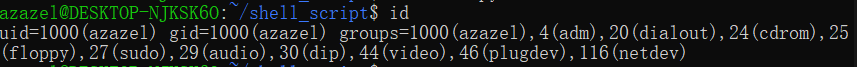
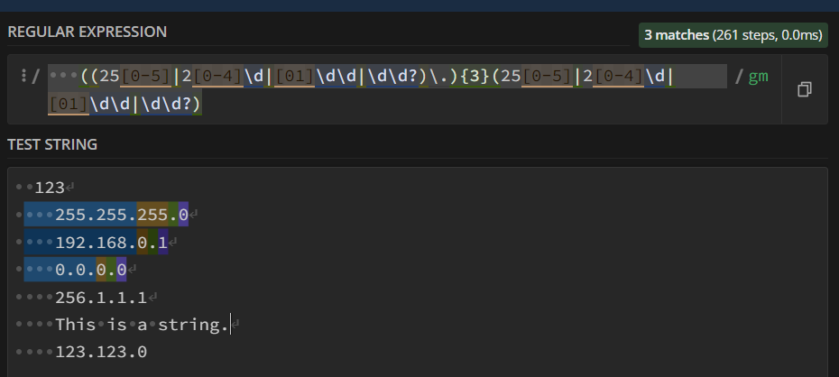

<!-- review-toc:start -->
<details>
<summary>复习目录（点击展开）</summary>

- [1 bash命令行](#1-bash命令行)
  - [1.1 常用bash命令](#11-常用bash命令)
  - [1.2 Here Document](#12-here-document)
  - [1.3 sed(streaming edit)工具](#13-sedstreaming-edit工具)
  - [1.4 常用工具与命令](#14-常用工具与命令)
- [2 如何编译C文件: 直接使用gcc/g++; MAKE命令和Makefile](#2-如何编译c文件-直接使用gccg-make命令和makefile)
  - [2.1 前言: 程序编译的四个步骤](#21-前言-程序编译的四个步骤)
  - [2.2 gcc（GNU Compiler Collection，GNU 编译器集合）](#22-gccgnu-compiler-collectiongnu-编译器集合)
  - [2.3 make命令的使用](#23-make命令的使用)
  - [2.4 Makefile 语法概述](#24-makefile-语法概述)
  - [2.5 编写Makefile例子1](#25-编写makefile例子1)
  - [2.6 编写Makefile, 用make进行编译 的一个综合例子](#26-编写makefile-用make进行编译-的一个综合例子)
  - [2.7 Makefile 杂项](#27-makefile-杂项)
  - [2.8 程序装载与 ELF](#28-程序装载与-elf)
  - [2.9 C 程序的静态库与共享库](#29-c-程序的静态库与共享库)
- [3 linux的用户(组)管理](#3-linux的用户组管理)
  - [3.1 用户组管理](#31-用户组管理)
  - [3.2 用户管理](#32-用户管理)
  - [3.3 修改文件(夹)的权限信息 chmod (change mode)命令](#33-修改文件夹的权限信息-chmod-change-mode命令)
  - [3.4 修改文件(夹)的所属用户(组) chown (change owner)](#34-修改文件夹的所属用户组-chown-change-owner)
- [4 Shell 语法、正则与环境](#4-shell-语法正则与环境)
  - [4.1 子 shell 与 source](#41-子-shell-与-source)
  - [4.2 万用字符(REGEX)](#42-万用字符regex)
  - [4.3 正则表达式](#43-正则表达式)
  - [4.4 路径结尾加不加/?](#44-路径结尾加不加)
  - [4.5 在当前路径检索时加上./是好习惯.](#45-在当前路径检索时加上是好习惯)
  - [4.6 过滤输出](#46-过滤输出)
  - [4.7 ? 变量](#47--变量)
  - [4.8 条件运算符](#48-条件运算符)
  - [4.9 source命令以及环境变量](#49-source命令以及环境变量)
  - [4.10 解压文件](#410-解压文件)
- [5 gdb](#5-gdb)
  - [5.1 🔹 启动 & 基本操作](#51--启动--基本操作)
  - [5.2 🔹 源码调试 命令列表](#52--源码调试-命令列表)
  - [5.3 汇编级调试 常用命令](#53-汇编级调试-常用命令)
  - [5.4 🔹 杂项 调试小技巧](#54--杂项-调试小技巧)
- [6 Git](#6-git)
- [7 进程](#7-进程)
  - [7.1 什麽是进程?](#71-什麽是进程)
  - [7.2 系统调用 syscall](#72-系统调用-syscall)
- [8 WSL](#8-wsl)
  - [8.1 WSL架构..](#81-wsl架构)
  - [8.2 wsl2和win10的交互复制粘贴方式.](#82-wsl2和win10的交互复制粘贴方式)
  - [8.3 运行脚本](#83-运行脚本)
  - [8.4 wsl的环境变量](#84-wsl的环境变量)
- [9 待补条目](#9-待补条目)

</details>
<!-- review-toc:end -->

配套：[Git 工具教程](Git工具教程.md) · [带注释的 linker.ld](linker.ld)

# 1 bash命令行 

linux中输入的命令行即为bash命令。每个bash命令是一个可执行程序(在/bin中储存). 创建一个可执行的bash命令行文件, 即为bash脚本script.

## 1.1 常用bash命令

### 1.1.1 man 

想要搜索的外部命令名可以跳转到该命令的man界面. 如果想查看bash内部命令, 比如cd, pwd, 使用help即可.
`man -k <keyword>` 可以输出所有简介中包含关键字的man条目供你选择, 而不是直接进入某个具体的man条目.

***
***
| 章节号 | 内容类型                                                          |
| :-: | :------------------------------------------------------------ |
|  1  | 用户命令（例如 `ls`, `cp`, `make`）                                   |
|  2  | **系统调用（syscalls）**，即进入内核的接口，如 `open`, `read`, `write`, `stat` |
|  3  | C 库函数（libc functions），比如 `printf`, `malloc`, `fopen`          |
|  4  | 设备文件和特殊文件说明（如 `/dev/null`）                                    |
|  5  | 文件格式、配置文件格式（如 `/etc/passwd`）                                  |
|  6  | 游戏或演示程序（早期 Unix 留下的）                                          |
|  7  | 协议、抽象概念（如 `man 7 socket`）                                     |
|  8  | 系统管理命令（root 用的命令，如 `mount`, `ifconfig`）                       |


### 1.1.2 find
find /指定路径下 -type f -name "filename" 
输出查找到的文件的路径. \
其中选项-type的参数为: -f(regular file), -d(directory), -l(symbolic link)等. -name可以替换为-iname, 即不区分大小写.
find经常和grep一起使用. find的结果|到grep中进行更细致的名称筛选. 比如find ~ -iname "my_first_program"和命令find ~ | grep -i "my_first_program"是等价的, 运行速度也几乎一样.

### 1.1.3 grep
格式为**grep -E "chars"**， 输出-E选项开启扩展正则表达式(ERE), 若没有这个选项, 系统会用基本正则表达式(BRE)来识别""内的字符. 
- 注意: BRE和ERE有不同: ERE支持 **|** 符号为"或", 而BRE需要用转义字符搭配 **/|** 为"或".


cat /etc/centos-release	查看centos版本。即cat显示命令和centos的版本信息存储地址.


### 1.1.4 xargs (extended arguments, 扩展参数)
- UNIX/Linux 命令的设计原则：
**命令行参数**：专门用于传递文件名或其他参数。
**标准输入stdin**：用于传递数据流。
函数根据不同的输入来源（命令行参数或标准输入）来采取不同的处理方式。命令行参数传递的是文件名，而标准输入传递的是数据流，这是 UNIX 命令处理输入的一种惯例和规范。 对大多数函数,如cat, wc, 如果没有指定命令行输入文件(即参数没有填), 它会将'input_desc'设置为'STDIN_FILENO',从标准输入(通常来自管道符|)中读取stdin. 而标准输入stdin是一个文本, 如果标准输入是一串参数(如一个读取出来的文件列表), 需要使用xargs将其转化为命令行参数. 例子:

```bash
azazel@DESKTOP-NJKSK6O:~/test/test$ wc -l testfile4.h
6 testfile4.h
azazel@DESKTOP-NJKSK6O:~/test/test$ vim testfile4.h
azazel@DESKTOP-NJKSK6O:~/test/test$ find . | grep ".c" | wc -l
2
azazel@DESKTOP-NJKSK6O:~/test/test$ find . | grep ".c" | xargs wc -l
0 ./testfile3.c
0 ./testfile1.c
0 total
```


### 1.1.5 wc (word count,词数统计)
**wc -l file**  输出file文件的行数(对一行的一句话,即显示字母数).\
- `-w`：显示单词数。
- `-m`：显示字符数（与 -c 类似，但在处理多字节字符时有所不同）。
- `-c`：显示字节数。


### 1.1.6 motion

这应该是vim的内容好吧!

[motion]包括 hjkl(四向), w(下一个word开头), e(下一个word ending), 0(当前line开头), ^(当前line不为空格的开头.), $(当前line ending), G(文档ending), gg(文档开头)等，即cursor移动操作。


### 1.1.7 磁盘管理命令 du df 
 
#### 1.1.7.1 du (disk usage磁盘使用情况)


- 格式:
**du -sc 路径**

- 选项 -s(--summarize), 只显示每个参数的总和, 不显示每个子目录的用量. 
- 选项 -c(--total), 最后加上一个总计.

#### 1.1.7.2 df (disk free, 显示文件系统的磁盘空间占用情况)
- 选项 -h (human-readable) 将输出格式化为易于阅读的形式，如以 KB、MB、GB 等单位显示，而不是以字节数显示。
- example
  ```bash
  df -h | tee disk_usage.txt    #将磁盘使用情况输出在终端上,并且存入文件disk_usage中
  ```

### 1.1.8 sort (数据排序工具)
经常以pipe(|)接前一个函数的输出流, 以达到整理后使输出更加美观/易读的目的.
- 格式: **sort -nr 文件(一般以某个路径下的全部(用通配符实现)子文件/.../*表示)**
- 选项 -n(numerical), 按数值排序
- 选项 -r(reverse), 降序. 

### 1.1.9 more & less

- more, 用于分页显示文件内容或输入。它一次显示一页内容，用户可以按空格键查看下一页，按 q 键退出。
- 格式: **more filename**
- 示例: 
```bash
more AVeryVeryLongDocument.txt
```

**less,比 more 更强大的逐屏查看文件内容工具。其命名是一个笑话(less>more). 常用操作：**

  - 按空格键（Space）滚动到下一屏。
  - 按 b(back) 键滚动到上一屏。
  - 按回车键（Enter）滚动一行。
  - 按 k 键向上滚动一行。
  - 按 j 键向下滚动一行。
* 📜 翻页
-   `Space` → 向下翻一页    
-   `b` → 向上翻一页    
-   `d` → 向下翻半页 (down half)    
-   `u` → 向上翻半页 (up half)    
* * *
* 🎯 跳转
-   `g` → 跳到文档开头    
-   `G` → 跳到文档末尾    
-   `:n` → 跳到第 _n_ 行 (比如 `:100`)   
* * *
* 👀 查看
-   `=` → 显示当前行号和总行数    
-   `-N` → 打开行号显示（输入 `-N` 再按回车）
    -   `/pattern` → 从当前位置往下搜索 `pattern`
    -   `?pattern` → 从当前位置往上搜索 `pattern` 
    -   `n` → 跳到下一个匹配结果   
    -   `N` → 跳到上一个匹配结果
    - 按 q 键退出。


### 1.1.10 tee(这个名字来自字母T, 一个三向接口, 寓意数据分流)
这个命令读取标准输入, 并将数据输出到多个目标中.
- 语法:
```bash
command | tee [options] [file...]
```
- 选项: 
  - -a 将内容append到文件最后, 而不是直接覆写文件. 
- example:

  ```bash
   ls -la | tee output.txt  #将当前文件列表显示在终端,同时保存在文件output.txt中
  ```
  ```bash
   echo "a new line" | tee -a file  #将新的一行文字append到file结尾, 同时在终端显示这行文字.
  ```


### 1.1.11 objdump(object dump, 对象转储)
用于显示和分析二进制文件的内容。在软件开发和逆向工程中，objdump 常用于反编译和查看程序的汇编代码。
格式为 `objdump <选项> <file>`
- 选项: 用于switch显示什麽信息(所以至少要填一个选项)
  - -S Intermix source code with disassembly,将源代码和反汇编代码混合显示.
  - -d disassembly, 反汇编所有可执行的节.
- example
  ```bash
  objdump -d myprog > disassembly_of_myprog.txt #将可执行程序myprog反汇编,将反汇编内容存储在disassembly_of_myprog.txt中.
  ```

### 1.1.12 time 记录其他命令的执行时间
在命令前面加上`time ` , 可以在执行命令后, 输出该命令的执行时间，包括 总耗时（real）、用户时间（user） 和 系统时间（sys）


### 1.1.13 网络和下载命令 curl scp 

#### 1.1.13.1 curl
**curl**用来从网络上获取数据. -s选项是silence模式,级不显示进度信息.
```bash
curl -s $URL
```

#### 1.1.13.2 scp (secure copy protocol, 安全拷贝协议)

它是基于ssh协议的命令, 用来在两台主机之间传输文件.

拷贝一台服务器上的文件(夹)到本地: (-r表示recursive, 传输文件夹.)
`scp -r <username>@<ip>:<目标服务器的文件(夹)路径> <想要保存的本地文件夹路径>`
对于windows的powershell, 可以用""包裹表示windows风格路径名: "windows路径名"


### 1.1.14 重定向符号 (< , > , &, >>)
`>` 把命令的标准输出（stdout）写入文件. Bash 中的 `&>` 把标准输出（stdout）和标准错误（stderr）一起重定向.
而>>表示把内容append到文件里而不是覆写.
`<` 把文件内容用作命令的标准输入（stdin）.

`<<`符号和`>>`符号完全不同! 
* `>>`是**追加重定向**加重**定向**(如`echo "hello">> file`)
* 而`<<`是**多行输入重定向**.
    ```bash
      cat <<EOF
      hello
      world
      EOF
    ```
`<<EOF`会让shell(bash(linux终端默认)也是一种shell)进入`多行输入模式`, 直到遇到`EOF`.


### 1.1.15 一些应用:
- ```bash
  > newfile #创建一个新文档newfile. (即,将'空'重定向到newfile中) 它和touch newfile不同在于后者更安全: 如果存在名字为newfile的文件, > newfile删除了其全部文件, 而touch newfile不会进行任何操作.
  ```

 - ```bash
   cat file1 > file2 #复制file1文档到file2文档. (即, 显示file1的文档内容, 将内容重定向到file2) 它和cp file1 file2效果大部分时候相同, 但事实上后者可以保留文件权限和元数据.

   ```
   
 - ```bash
   ./myprog < data.txt  #如果myprog需要从键盘上读入大量数据(例如一个图的拓扑结构), 当你需要反复对myprog进行测试的时候, 你需要多次键入大量相同的数据. 只需要将myprog读入的数据一次性输入到文件data中, myprog就会从文件data中读入数据, 节省了大量的时间.
   ```
> 此处示例待补。


### 1.1.16 程序和进程命令 ps init

#### 1.1.16.1 ps (process status)检查进程.

```bash
ps -p 1 -o comm=
```
`-p 1`表示查看pid=1的进程. 系统的第一个进程即为`init进程`.

`-o comm=`表示指定输出格式为command(命令名), `=`表示去掉标题行(不显示列名)

这条命令查看系统初始化进程(init进程)叫什麽.

#### 1.1.16.2 init进程


初始化进程是系统开机时第一个被运行的程序!

它管理:
  * 启动服务;
  * 日志;
  * 启动流程;等等.


不同的linux系统的init进程不一定一样.
现在大多数主流 Linux 发行版（如 Ubuntu 16.04+、Debian 8+、CentOS 7+）都默认使用 **systemd**
  常用命令:(`systemctl` 是 systemd 提供的命令行工具。)
  任务                |              命令
  查看 ssh 服务状态   | systemctl status sshd
  启动 ssh 服务       | sudo systemctl start sshd
  设置开机启动 ssh    | sudo systemctl enable sshd
  重启 ssh 服务       | sudo systemctl restart sshd
一些系统(特别是轻量级系统、嵌入式环境、HPC 环境, 容器) 可能有其他的init进程, 

比如有些容器/非常轻量的虚拟环境等, 会使用**sh**, 即shell. 这意味着这个**系统**本质上只是个运行shell的环境罢了.


### 1.1.17 tree 显示目录结构

⚠注意bash中的tree和 powershell中的tree语法不同!!!

bash:
    tree -L [层数]  这是我最喜欢的功能! 搜索深度为[层数]层目录显示.
    tree -d         只显示文件夹, 不显示文件.
    tree -a         显示隐藏

powershell:
    tree      输出当前目录树(只包含文件夹. 这个默认是和bash相反的, 毕竟powershell助长易用性和懒人)
    tree /F   输出当前目录树(包含文件夹和所有文件)(一般会超级爆炸长)
    tree /A   输出当前目录, 以ASCII字符的方式.(我觉得没啥区别, 无非就是树枝符号变更丑了. 即使是非ascii符号一般情况下也可以复制粘贴和在大部分地方显示的啦...)


## 1.2 Here Document

又称heredoc, 是bash中一种多行文本输入方式, 语法:

```bash
command <<结束标记
内容内容
内容内容
结束标记
```

当你以`<<EOF`结束一行后, 按下回车, bash自动进入换行模式, 一直等待直到某一行你输入单独的`EOF`并回车.
例如如果你想要写一个简单的c程序:

```bash
cat > test.cpp << MY_EOF_SIGNAL
//this is my test program. just press ENTER.
#include iostream //just press ENTER!

int main(){
cout>>"hello world!";
return 0;
}
MY_EOF_SIGNAL
```


## 1.3 sed(streaming edit)工具

对文本做查找/替换/插入/删除， 一个sed即可。


最常见格式:

```
sed 's/原内容/新内容/[可选选项]'
```

其中的分隔符`/`可以被换为: `+`, `|`, `#`, `@`. 这样设计是考虑到原内容和新内容可能包含某个分隔符, 故冗余设计.

常用可选选项:
* g: global. 不加的话, 每一行只替换一次就不管了.


| 选项 | 作用 | 举例 |
| --- | --- | --- |
| `-e 'script'` | 执行一段脚本, 可多次出现 | `sed -e 's/cat/dog/' -e 's/mew/purr/' file` |
| `-f file` | 从文件读取脚本 | `sed -f rules.sed input.txt` |
| `-n` | 只按 `p` 等命令显式打印 | `sed -n 's/foo/bar/p' file` |
| `-i[SUFFIX]` | 原地修改, 可加备份后缀 | `sed -i.bak 's/foo/bar/g' file` |
| `-r` 或 `-E` | 使用扩展正则表达式 | `sed -E 's/(ab)+/X/' file` |
| `-u` | 使用较少缓冲, 便于实时输出 | `tail -f log \| sed -u 's/error/⚠️/'` |

| 命令           | 功能        | 示例                               |
| ------------ | --------- | -------------------------------- |
| `s/旧/新/g`    | 替换文本      | `sed 's/cat/dog/g'`              |
| `p`          | 打印匹配行     | `sed -n '/hello/p'`              |
| `d`          | 删除匹配行     | `sed '/^#/d'`（删掉注释）              |
| `a\text`     | 在匹配行后追加一行 | `sed '/pattern/a\new line'`      |
| `i\text`     | 在匹配行前插入一行 | `sed '/pattern/i\before this'`   |
| `c\text`     | 替换整行      | `sed '/pattern/c\replaced line'` |
| `y/abc/ABC/` | 单字符替换     | `sed 'y/abc/ABC/'`（类似 `tr`）      |
| `q`          | 提前退出      | `sed '5q'`（只处理前5行）               |
| `=`          | 打印行号      | `sed '=' file`                   |

| 命令 | 说明 |
| --- | --- |
| `sed -n 's/foo/bar/p' file` | 只打印替换成功的行 |
| `sed -i 's/foo/bar/g' file` | 原地替换全部 foo |
| `sed -E 's/(cat\|dog)/pet/g' file` | 使用扩展正则 |
| `sed '/^$/d' file` | 删除空行 |
| `sed -e '/^#/d' -e '/^$/d' file` | 删除注释和空行 |

-   `-i` **危险但常用**：会直接修改文件内容；
    
    -   `-i.bak` 会先生成一个 `file.bak` 备份。
        
-   `-n` 一般配合 `p`，否则 `sed` 默认会打印每行。
    
-   `-E` 比 `-r` 更现代（GNU、BSD 都支持），推荐用 `-E`。

### 1.3.1 sed 基本语法与打印指定行

sed 是一个流编辑器 (stream editor), 它可以对文本进行过滤和转换.

基本语法: 

```bash
sed [options] 'script' file
```

最常用的几个用法:

```bash
sed -n '90, 100p' file  # 打印 file 的第 90 行到第 100 行. `-n`是静默模式, p是print.

```

## 1.4 常用工具与命令

### 1.4.1 常用命令与环境变量


* $(nproc)
  * Number of PROCessors

### 1.4.2 nano

**nano 的设计哲学：**

-   **所见即所得** - 直接输入文字
    
-   **无模式切换** - 不需要在普通模式、插入模式之间切换
    
-   **快捷键组合** - 所有功能都用 Ctrl/Alt 组合键完成


#### 1.4.2.1 基本导航

-   **光标移动**：直接使用方向键
    
-   **转到文件开头**：`Alt+\` 或 `Alt+Home`
    
-   **转到文件结尾**：`Alt+/` 或 `Alt+End`
    
-   **转到行首**：`Ctrl+A`
    
-   **转到行尾**：`Ctrl+E`
    

#### 1.4.2.2 编辑操作

-   **撤销**：`Alt+U`
    
-   **重做**：`Alt+E`
    
-   **复制**：`Alt+6` 或 `Ctrl+6`（先标记，然后移动光标选择区域）
    
-   **剪切**：`Ctrl+K`
    
-   **粘贴**：`Ctrl+U`
    

#### 1.4.2.3 搜索和替换

-   **搜索**：`Ctrl+W`
    
-   **替换**：`Ctrl+\`
    

#### 1.4.2.4 文件操作

-   **保存**：`Ctrl+O`
    
-   **退出**：`Ctrl+X`
    

#### 1.4.2.5 帮助

-   **显示帮助**：`Ctrl+G` - 所有快捷键都会显示在屏幕底部


### 1.4.3 ccache

ubuntu自装. 在`/usr/lib/ccache/`

配置:

先确定装了没有:
```bash
which ccache
```

在./.bashrc最后加入`export PATH="/usr/lib/ccache:$PATH"`


原理:`/usr/lib/ccache/gcc`是一个和gcc同名的脚本文件.

在PATH的开头插入该路径, 导致用户输入`gcc`命令的时候优先选择`/usr/lib/ccache/gcc`, 劫持了真正的gcc编译器. 而前者就是ccache设计的包装器. 它自动管理什麽时候用缓存, 什麽时候调用gcc重新编译.

类似的劫持做法:

-   **ccache**：劫持 gcc, g++, clang 等编译命令
    
-   **virtualenv**：劫持 python, pip 命令
    
-   **nvm**：劫持 node, npm 命令
    
-   **conda**：劫持各种科学计算命令


```
ccache确实跳过了完全重复的编译过程, 发挥了加速的作用. 如果和多线程编译共同使用, 编译速度还能进一步加快!

在开发项目的过程中, 有时确实会需要在清除编译结果后进行全新的编译(fresh build). 到了PA的后期, 你可能会多次编译一些包含数百个文件的库, 在这些场合下, ccache能够极大地节省编译的时间, 从而提高项目开发的效率.
```

### 1.4.4 fceux-am

这是一个红白机模拟器项目...


### 1.4.5 strace

这是 Linux 下的一个系统调用跟踪工具，它能记录程序执行过程中所有的系统调用（比如 open、read、write、mmap、execve 等）。

也就是说，它能看到程序“和内核之间都说了啥”。 

例子:

`strace -f -o strace.log make --debug=v`

| 选项               | 含义                                              |
| ---------------- | ----------------------------------------------- |
| `-f`             | 跟踪所有由主进程创建的子进程（比如 `make` 会 fork 出许多编译子进程）       |
| `-o strace.log`  | 把输出保存到 `strace.log` 文件中，而不是直接打印到终端              |
| `make --debug=v` | 执行 `make` 命令，并启用 **verbose 模式**，显示 make 的详细调试输出 |

# 2 如何编译C文件: 直接使用gcc/g++; MAKE命令和Makefile

如果你不想写好一个c文件然后`gcc yourcode.c`(如果你的yourcode.c要包含其他文件, 要让它们在同目录下.)

抑或是写好一个cpp然后`g++ yourcode.cpp`(如果你的yourcode.c要包含其他文件, 要让它们在同目录下.)

那麽使用make吧.

大多数linux发行版预装了MAKE.
`make -v`

## 2.1 前言: 程序编译的四个步骤

### 2.1.1 预处理（Preprocessing）
- 任务: 在编译源代码之前，对代码进行初步处理。

- 操作:  宏替换: 替换 #define 定义的宏。例如，将 #define PI 3.14 替换成 3.14。
文件包含: 处理 #include 指令，插入所包含的头文件内容。
条件编译: 处理条件编译指令，如 #ifdef 和 #endif，只编译符合条件的代码块。

- 结果: 输出一个中间文件，通常是扩展名为 **.i** 的文件，包含了经过预处理的源代码。

### 2.1.2 编译（Compilation）
- 任务: 将预处理后的源代码转换为汇编代码。

- 操作:  语法分析: 检查代码是否符合语言的语法规则。
生成中间代码: 将源代码转换为中间表示，如抽象语法树（AST）或中间语言（IR）。
优化: 对中间代码进行优化，以提高效率。

- 结果: 输出一个汇编语言代码文件，通常是扩展名为 **.s** 的文件。

### 2.1.3 汇编（Assembly）
- 任务: 将汇编语言代码转换为机器代码。

- 操作:  汇编: 将汇编语言代码翻译成机器语言指令（即机器码），这些指令是计算机可以直接执行的。
生成目标文件: 输出 **目标文件** ，通常是扩展名为 **.o** 或 **.obj** 的文件，包含机器代码和其他必要的符号信息。

- 结果: **目标文件**，包含了编译生成的机器码，但还不是最终的可执行文件。

### 2.1.4 链接（Linking）
- 任务: 将目标文件与所需的库文件合并，生成最终的可执行文件。

- 操作:  符号解析: 处理目标文件中未定义的符号，链接到库文件中的相应定义。例如，处理函数调用。
地址分配: 分配内存地址，确保所有代码和数据都放在正确的位置。
生成可执行文件: 输出最终的可执行文件，通常是没有扩展名的文件（如 program）或带有 .exe 扩展名的文件。
- 结果: 完整的可执行文件，可以在计算机上运行。

## 2.2 gcc（GNU Compiler Collection，GNU 编译器集合）

最简单的编译命令.
gcc会根据**提供文件类型**和**选项**自动决定处理阶段:
|选项|输入文件|行为|output|
|---|---|---|---|
|无|.c|预处理->compile->汇编->link|可执行文件|
|无|.i|compile->汇编->link|可执行文件|
|无|.o|link|可执行文件|
|-c|.c|预处理->compile->汇编|.o目标文件|
|-E|.c|预处理|.i预处理文件|


- 基本命令：

  ```bash
  gcc [选项] [源文件] -o [输出文件]
  gcc [选项] -o [输出文件] [源文件]
  ```

  `-o` 后面跟输出文件名；源文件可放在前后. 此命令默认把 `.c` 编译并链接为可执行文件.
- 选项`-o`表示输出文件的名称(如果不加-o [输出文件], 则在则会默认生成名为a.out的文件, 它的含义是assembler output)
- 选项-O:优化代码. 有-O1(一级优化), -O2(二级优化), -O3(三级优化)三个等级.
- 选项 `-g`：生成调试信息.
- 选项`-c`: 即compile, 生成目标文件 `.o`, 不进行链接.

**例子:**
* `gcc hello.c -o hello`
  * 在当前目录寻找`hello.c`, 将其编译为可执行程序`hello`
* **只编译**: `gcc -c hello.c -o hello.o`
  * 在当前目录寻找`hello.c`, 将其编译为目标文件`hello.o`
* **只预处理**: `gcc -E hello.c -o hello.i`
  * 在当前目录寻找`hello.c`, 将其预处理为目标文件`hello.i`  
* **分步编译**: 
```bash
#编译每个.c文件为.o文件. 注意要在代码中正确写好include头文件
gcc -c main.c -o main.o
gcc -c utils.c -o utils.o 

#链接所有编译单元(即.o文件)
gcc main.o utils.o -o myprogram
```
* 启用警告和调试信息:`gcc -Wall -Wextra -g main.c -o debug_app`
  * `-Wall`: 启用所有常见警告
  * `-Wextra`: 启用额外警告(如未初始化的变量)
  * `-g`: 添加调试信息, 供`gdb`使用

* 优化代码性能(牺牲编译时间): `gcc -O2 main.c -o myprogram`
  * `-O1`: 添加该选项后, 进行基础优化. 编译更慢, 优化更好.
  * `-O2`: 推荐的平衡级别.
  * `-O3`: 激进优化. 可能会影响代码行为..

* 链接外部库: `gcc main.c -lm -lpthread -o myprogram`
  * `-lm`:

* 指定头文件和库路径: `gcc -I./include -L./lib program.c -lmylib -o app`
  * -I和-L选项指定了头文件在 ./include，库文件在 ./lib。
  * -lmylib：链接 libmylib.so。

* 静态链接: `gcc -static main.c -o static_app`
  * -static选项生成不依赖动态库的可执行文件, 适合分发, 文件体积显著增大.

* 检查语法: `gcc -fsyntax-only main.c`
  * `-fsyntax-only`选项: 快速验证代码语法是否正确（无需编译）。

* 并行构建由 `make` 调度：`make -j4` 或 `make -j$(nproc)`. `gcc` 没有通用的 `-j4` 选项；GNU make 的 `-j` 不带数字表示不限制并行任务数, 不能把 `-j0` 当作自动使用全部核心.

## 2.3 make命令的使用

**make命令**利用Makefile(一个txt)工作, 用于自动化编译和构建程序的过程。使用方法是在项目文件夹中同时放入源文件和一个名为Makefile的文本文件, 然后在当前项目文件夹目录下直接键入命令make.

**bash命令的基本用法:**

```bash
make #编译项目. 查找当前目录的Makefile, 执行默认目标`all`.

make mycode_main.cpp #制定目标编译项目. 查找当前目录的Makefile中有没有叫做`mycode_main.cpp`的target, 如果有, 执行这个target. 如果没有找到, 或者甚至根本没有找到Makefile, 查找当前目录中的`mycode_main.cpp, 编译它.`

```


```bash
make -j -C obj_dir -f Vour.mk Vour
```
* `-j` 多线程并行编译
* `-C [路径]` 切换到[路径]再运行make
* `-f Vour.mk` **使用指定的Makeifle文件`Vour.mk`来编译**
* `Vour` 编译的目标名. 


***
***
***
***
***
其他常用make选项:

* --debug: 执行make命令的同时打印调试信息. 可以带参数. 如果不带参数, 则效果同-d
  * `make --debug=[FLAGS]`
  * | 参数  | 含义                               |
    | --- | -------------------------------- |
    | `a` | 所有调试信息（相当于 `-d`）                 |
    | `b` | 只显示与目标更新（build）相关的信息             |
    | `v` | 显示变量赋值（variable assignments）相关信息 |
    | `i` | 显示隐式规则（implicit rules）推导信息       |
    | `j` | 显示并行执行（jobs）相关信息                 |
    | `m` | 显示 `make` 的内部文件读入信息              |
    | `n` | 显示数据库状态（类似于 `make -p`）           |
* -d: 打印所有详细调试信息.
* `-n` : print the commands that would be executed. **只打印命令, 不执行, 适合调试!**
* `---trace`: 输出目标被构建的原因 + 执行的命令.
* `-B`: 重新构建所有目标.
* `-nB`: 调试经常用. 看看make如何从0开始构建整个目标.


## 2.4 Makefile 语法概述

如果要使用make, 需要编写**Makefile**.

* Makefile
是一个特定格式(见下文)的文本文件, 它由:
* **变量声明**
* **一个个规则**
组成.

* **变量部分**
| 变量名   | 默认值 | 作用                     |
|----------|--------|--------------------------|
| `CC`     | `cc`   | C 编译器（通常链接到 gcc） |
| `CFLAGS` | 空     | C 编译选项                |
| `LDFLAGS`| 空     | 链接选项                  |
| `CPPFLAGS`| 空    | 预处理选项（如 `-I`）     |


* **规则部分:**
每个规则通常包含三个部分: 
- **目标(target)**：要创建或更新的文件或对象。这通常是可执行文件或目标文件。
- **先决条件/依赖(dependencies/Prerequisites)**：目标所依赖的文件。如果这些文件中的任何一个发生更改，目标将被重建。
- **Recipe** : make 将执行的命令来创建或更新目标。这些命令必须使用`Tab`缩进。

**格式**: 这是一个**目标文件为`target`, 依赖文件为`dependencies`, 执行命令为`recipe`的规则.**
```Makefile
target: dependencies
  recipe
```


例如, 若想使用bash命令`make clean`, 你的Makefile中必须写好了下面这个clean规则:(假设你在项目ex3目录中)

```Makefile
clean:
  rm -f ex3
```


**make的行为:**

* 当其他地方需要依赖`target`, 或显式运行命令`make target`时, make会开始执行`target`这条规则.
* make首先寻找依赖`dependencies`文件是否存在. 如果不存在, 则去寻找目标文件为`dependencies`的规则. 
* 如果依赖`dependencies`文件存在, 则运行指令`recipe`. 运行完后, 查看此时`target`是否存在. **如果存在, 结束, return 0. 如果不存在, 构建失败, return -1.**


## 2.5 编写Makefile例子1
* 例子1: 将当前文件夹内的hello.c编译为hello.


```bash

#任务很简单, 就不声明那些变量了, 让make默认吧.

hello:hello.c
	gcc hello.c -o hello	#

.PHONY: clean  
 #.PHONY: targetName是一种特殊的指令，用于告诉 make，clean 是一个伪目标（也就是不与某个具体文件相关的目标）。这可以防止有同名文件时的冲突。
 #在 Makefile 中，目标target通常对应于要生成的文件，例如可执行文件或编译后的目标文件。但有时，目标可能不会生成一个文件，而是用于执行某个动作，比如清理编译生成的文件。这些目标就是伪目标（phony targets）。
 #如果你在当前目录下有一个名字叫 clean 的文件，而你在 Makefile 中也有一个 clean 目标，那么 make clean 时，Makefile 可能会认为目标已经满足，而不会执行清理操作。使用 .PHONY 可以告诉 make 这个目标是伪造的，不要检查同名文件是否存在。


#clean规则. 显然它不需要dependencies.
clean:
	rm hello	
```

* 例子2: 有main.c和utils.c两个编译单元.
```Makefile
#假设你已经有了源文件 main.c 和 utils.c
# 变量定义
CC = gcc
CFLAGS = -Wall -g
OBJ = main.o utils.o

# 默认目标
all: my_program   
#如果只运行 make，则默认构建 my_program。

# 生成目标 my_program
my_program: $(OBJ)
	$(CC) $(CFLAGS) -o my_program $(OBJ)
#多个依赖项是很常见的，特别是在较大的项目中，一个目标可能依赖于多个文件或组件。链接器（linker）将 main.o 和 utils.o 合并，生成最终的可执行文件 my_program。


# 生成目标 main.o
main.o: main.c
	$(CC) $(CFLAGS) -c main.c
#这里使用依赖为main.o utils.o, 而不是源文件main.c utils.c. 
#这是因为, 当 .c 文件发生变化时，需要重新编译这些源文件，生成新的 .o 文件。如果你直接在 Makefile 中指定 .c 文件作为依赖项，那么每次你运行 make 时，它都会重新编译所有的 .c 文件，即使 .o 文件没有变化。这样不够高效。
#通过使用 .o 文件作为依赖项，make 只会在 .c 文件发生变化时重新编译相应的 .o 文件，从而节省时间。


# 生成目标 utils.o
utils.o: utils.c
	$(CC) $(CFLAGS) -c utils.c

# 清理目标
clean:
	rm -f *.o my_program  
#删除所有对象文件和 my_program 可执行文件。
```
例子3: 实现对文件夹里所有ex[0-9]*.c的文件进行编译.
```makefile
#变量定义
CC = gcc
CFLAGS = -Wall -g

#清理生成的文件
clean:
        rm -f ex*

#默认目标.
#patsubst即pattern substitution, makefile中的字符串模式替换函数, 格式为$(patsubst <pattern>, <replacement>, <text>)
#wildcard即makefile中的万用字符函数, 格式为$(wildcard <表达式>)
all:$(patsubst %.c, %, $(wildcard ex[0-9]*.c))

#生成目标
# % 通配符表示任何字符串.
# $@ 表示当前规则的目标文件.
# $< 表示规则中第一个依赖文件.
%:%.c
        $(CC) $(CFLAGS)  -o $@ $<
```

## 2.6 编写Makefile, 用make进行编译 的一个综合例子

### 2.6.1 例程内容
现在有一个简单的项目: main.c主程序, 以及一个`math_utils`模块, 包括math_utils.h和math_utils.c两个文件.

* math_utils.h
```cpp
#ifndef MATH_UTILS_H
#define MATH_UTILS_H

int add(int a, int b);
int multiply(int a, int b);

#endif
```

* math_utils.c
```cpp
#include "math_utils.h"

int add(int a, int b) {
    return a + b;
}

int multiply(int a, int b) {
    return a * b;
}
```


* main.c
```cpp
#include <stdio.h>
#include "math_utils.h"  // 依赖 math_utils.h

int main() {
    printf("3 + 5 = %d\n", add(3, 5));
    printf("3 * 5 = %d\n", multiply(3, 5));
    return 0;
}
```

### 2.6.2 手动编译这个例程


如果手动编译, 需要把三个文件放在一个目录下, 然后使用gcc.
要添加所有参与编译的.c文件.

```bash
gcc main.c math_utils.c -o myprogram
```


### 2.6.3 写Makefile编译这个例程


**下面我们编写这个例程的Makefile.**

```Makefile
# 定义编译器和选项
CC = gcc
CFLAGS = -Wall -Wextra#启用额外警告

#你想要生成的可执行文件名字
TARGET = myprogram

# 约定用法: 变量SRCS, 项目文件列表. 这就对应IDE中的项目文件列表. 告诉编译器, 这些文件要参与编译.
SRCS = main.c math_utils.c 


# 约定用法: 变量OBJS, 目标文件列表. 为 make 和linker提供明确的中间文件列表。
# 虽然按理说所有的.c编译单元对应生成一个.o, 但是Makefile提供OBJS变量原因:
# 1.可以在特殊情况下控制哪些编译文件被link, 
# 2.而且可以实现增量构建(Partial Rebuild): 只编译修改过的文件而不是重新编译整个项目. 有了OBJS列表, 当你修改一个文件xx.c或.h后, make 会一个个检查OBJS中的目标文件, 当这个目标文件依赖xx.c时, 才会重新编译这个目标文件.
# 大部分情况下直接OBJS = $(SRCS:.c=.o)就可以了...
# 语法上, 这句话的意思是, 将`字符串数组`变量SRCS中所有字符串中`.c`都替换为`.o`(得到一个中间变量), 然后赋值给OBJS.
# 这样做的好处就是你只需要维护一个SRCS, 如果加入一个newmodule.c, 会自动在OBJS添加一个newmodule.o.
OBJS = $(SRCS:.c=.o)

# 命令行住直接运行make, 不指定target时, make会执行`all`默认目标. 也就是说在命令行中, `make`和`make all`命令等价.
# $符号即引用变量的值. 此处的`all: $(TARGET)`等价于`all: myprogram`.
all: $(TARGET)


#上面是定义本makefile要用的变量. 下面就是一个个makefile规则. 一个makefile的结构:
# target: dependencies
#     recipe
# 其中target是一个字符串, 表示要生成的可执行文件的名字.
# dependencies是字符串数组, 表示生成这个可执行文件需要的所有依赖.o文件名称.
# recipe是生成target要执行的命令.必须以Tab开头哦
# $@表示当前目标, 即$(TARGET), 
# $^代表所有依赖文件,即 $(OBJS), 
# $<表示第一个依赖文件（如 main.c）
$(TARGET): $(OBJS)
	$(CC) $(CFLAGS) -o $@ $^


# 编译每个 .c 文件到 .o 文件（依赖对应的 .h）
%.o: %.c math_utils.h
	$(CC) $(CFLAGS) -c $< -o $@

```

-
* 如果没有 `Makefile`，`make` 会自动尝试使用默认的编译命令。
  * 此时， 如果输入`make ex1`, 命令会尝试查找名字带有ex1的文件, 如`ex1.c`,`ex1.cpp`等, 如果找到并唯一, 就以此为**依赖**,  创建一个ex1可执行文件作为**目标**, 同时输出他刚刚执行的编译命令,即`cc     ex1.c   -o ex1`
* 每次运行make命令时, make会检查源文件和目标文件(如果已经存在同名目标文件)的时间戳. 如果发现目标文件已经存在, 并且时间戳新于所有依赖源文件, 那麽会停止命令, 并且输出"make: 'hello' is up to date."(没有需要更新的文件)
* 在make命令前加上对环境变量`CFLAGS`的改变, 可以在编译时启动所有警告显式. 


```
CFLAGS "-Wall" make ex1
```

  也可以在Makefile里添加对这个环境变量的修改. 下面是一个Makefile:
  ```Makefile
  CFLAGS=-Wall -g #将环境变量CFLAGS修改为-Wall以启用所有常见编译警告. g选项生成调试信息.

  clean:
    rm -f ex1
  ```
* `make clean` 该命令将当前目录由编译器生成的可执行文件删除. 方便你重新开始生成可执行文件.


## 2.7 Makefile 杂项

### 2.7.1 make的内置函数

语法:
`$(fun arg)`

常用的有shell, dir等


查表!


**🏗️ 文件路径类**
| 函数                           | 作用         | 示例                             | 结果                  |
| ---------------------------- | ---------- | ------------------------------ | ------------------- |
| `$(dir file)`                | 取路径部分      | `$(dir src/foo.c)`             | `src/`              |
| `$(notdir file)`             | 去掉路径，只取文件名 | `$(notdir src/foo.c)`          | `foo.c`             |
| `$(basename file)`           | 去掉扩展名      | `$(basename foo.c)`            | `foo`               |
| `$(addsuffix suffix, names)` | 给每个元素加后缀   | `$(addsuffix .o, a b)`         | `a.o b.o`           |
| `$(addprefix prefix, names)` | 给每个元素加前缀   | `$(addprefix src/, main util)` | `src/main src/util` |
| `$(join list1, list2)`       | 将两个列表逐一连接  | `$(join a b, .o .c)`           | `a.o b.c`           |

*******************************
**🧩 字符串处理类**
| 函数                                     | 作用      | 示例                                | 结果            |
| -------------------------------------- | ------- | --------------------------------- | ------------- |
| `$(subst from,to,text)`                | 简单替换    | `$(subst .c,.o,foo.c bar.c)`      | `foo.o bar.o` |
| `$(patsubst pattern,replacement,text)` | 模式替换    | `$(patsubst %.c,%.o,foo.c bar.c)` | `foo.o bar.o` |
| `$(filter pattern,text)`               | 保留匹配的单词 | `$(filter %.c, a.c b.o c.c)`      | `a.c c.c`     |
| `$(filter-out pattern,text)`           | 去掉匹配的单词 | `$(filter-out %.o, a.c b.o c.c)`  | `a.c c.c`     |
| `$(sort list)`                         | 去重并排序   | `$(sort b a a c)`                 | `a b c`       |

*******************************
**🧮 控制流类**
| 函数                            | 作用              | 示例                          | 说明                      |
| ----------------------------- | --------------- | --------------------------- | ----------------------- |
| `$(if condition,then[,else])` | 条件判断            | `$(if $(VAR),yes,no)`       | 若 `VAR` 非空则输出 yes，否则 no |
| `$(foreach var,list,text)`    | 循环              | `$(foreach x,a b,c_$(x))`   | 结果：`c_a c_b`            |
| `$(call func,args...)`        | 调用自定义函数         | `$(call myfunc,arg1,arg2)`  | 调用通过 `define` 定义的函数     |
| `$(shell command)`            | **执行 Shell 命令** | `$(shell pwd)`              | 输出当前目录                  |
| `$(error text)`               | 报错并停止           | `$(error Something wrong!)` | ——                      |
| `$(warning text)`             | 打印警告但继续执行       | `$(warning Not found!)`     | ——                      |

### 2.7.2 make的字符串替换语法

和内置函数语法很像, 也是`$()`结构.


```
$(var:pattern=replacement)

```


### 2.7.3 makefile和bash的括号()区别

bash中加括号和不加括号含义不同.

| 写法           | 含义                         |
| ------------ | -------------------------- |
| `$VAR`       | 取变量的值（例如 `$HOME`）          |
| `$(command)` | 执行命令并返回输出结果（命令替换）          |
| `${VAR}`     | 明确界定变量边界（和 `$VAR` 类似，但更安全） |


| 写法             | 含义                                    |
| -------------- | ------------------------------------- |
| `$@`           | 自动变量（表示“目标文件名”）                       |
| `$<`           | 自动变量（表示“第一个依赖文件”）                     |
| `$(VAR)`       | 取 Makefile 中定义的变量值                    |
| `$(shell cmd)` | ✅ 想执行命令要用这个特殊函数！它才等价于 Bash 的 `$(cmd)` |
| `$VAR`       | 仅仅表示字符串`$VAR`                    |


### 2.7.4 $(shell)和$(wildcard)的区别

想要找当前目录所有`.c`文件, $(shell ls *.c)和`$(wildcard *.c)`都可以完成这件事.


| 对比项      | `$(wildcard *.c)`   | `$(shell ls *.c)`         |
| :------- | :------------------ | :------------------------ |
| 类型       | **Make 内置函数**       | **调用外部 shell 命令**         |
| 执行环境     | 在 Make 自己内部解析       | 在系统 Shell（如 `/bin/sh`）中运行 |
| 是否依赖外部命令 | ❌ 不依赖（更快、更安全）       | ✅ 依赖 `ls` 命令（可能出错）        |
| 错误行为     | 如果找不到匹配，返回空字符串      | 如果找不到匹配，`ls` 会报错          |
| 性能       | ✅ 快（纯 Make 内部操作）    | ❌ 慢（要启动一个 shell 进程）       |
| 跨平台兼容性   | ✅ 高（GNU make 自己实现的） | ❌ 低（不同系统 `ls` 输出格式不同）     |


### 2.7.5 单目标有多个规则?

连接`target`和`dependencies`可以用`:`也可以用`::`
| 用法       | 含义                     |
| -------- | ---------------------- |
| 单冒号 `:`  | 同一目标只能有一个规则，后面定义的会覆盖前面 |
| 双冒号 `::` | 可以为同一目标定义多个独立规则，彼此不冲突.  |

如果用`::`, 让同一个目标有两个规则:

```Makefile
foo:: a.txt
	echo "rule 1: build foo from a.txt" > foo

foo:: b.txt
	echo "rule 2: postprocess foo" >> foo
```

现在我们运行`make foo`, 则会先执行第一个`foo:: a.txt`规则. 然后第二个规则会因为foo存在且比依赖b.txt更新而被忽略掉.

这种场合下`::`似乎显得很奇怪用不到.

一般`::`用在这样的场合:

主mk有一个总伪目标make run, 其中有一些要构建的东西;

而这个项目基于不同的参数, 会在不同场合include不同的子mk. 

于是不同的子mk也有一个run规则, 此时主mk和子mk的run规则都`::`.

**伪目标无论如何都会执行. 只要某个目标被标记为 .PHONY，GNU Make 就会认为它永远是“过期的”(out-of-date).**


**多个同名`::`的伪目标全都会依次执行.**

### 2.7.6 Makefile 变量、注释与命令补充

* Makefile 允许行尾注释, 但变量值末尾、`#` 前面的空格可能被保留. 例如 `TOPNAME = top   # 注释` 中的尾部空格容易造成问题；把说明单独成行更稳妥.

* **优先级**: Makefile中, 变量赋值加载顺序是语句先后. 后面覆盖前面. 可以用?=(最低优先级),  `override a=5`(最高优先级). 命令行 `make a=5` 通常覆盖 Makefile 的普通赋值, 但 Makefile 中的 `override` 可以覆盖命令行赋值

* 关键词变量. Makefile有一些约定俗成的变量（常见的“内部变量”）. 这些变量虽然 不是 Makefile 的关键字，但 make 及编译工具默认会识别：
* CC：指定 C 编译器（GNU make 内建默认通常为 cc）
* CXX：指定 C++ 编译器（默认为 g++）
* CFLAGS：C 编译选项
* CXXFLAGS：C++ 编译选项
* LDFLAGS：链接选项（影响最终生成的可执行文件）.
	* `LDFLAGS`是Makefile内部参数, 用于指定`链接器`linker. +=表示在已有值上append新选项. -l库名表示链接该库.
* CPPFLAGS：预处理选项（如 -I 头文件路径）
* LDLIBS：库文件（通常是 -l 选项，但和 LDFLAGS 不同，它出现在链接命令的 最后）
	
* 下面是一些注释笔记.
```Makefile
# 那些在TARGET(:build)块外的等式, 意义是: 变量TOPNAME的值是"top", 可以用$(TOPNAME)得到字符串"top". 顺带, Makefile有严格的缩进要求, TARGET块内的命令必须缩进.
# `?=`意味着, 考虑`INC_PATH?=`, 如果INC_PATH变量还没有被定义, 则定义其值为""(空). 如果外部已传入, 比如用户输入命令`make INC_PATH=/somepath`, 则该行语句不执行.
#default 目标块在用户没有指定目标的时候执行. 比如用户输入`make`.  此处具体来说执行的是`./build/top`. 如果用户输入`make build`, 则执行build目标块.
# `$^`表示所有依赖文件的列表, `@(bash command)`表示执行之后的bash command但不在终端显示命令.
```

## 2.8 程序装载与 ELF

### 2.8.1 程序加载与链接地址

编译程序时认为指令将来放在那里. 软件构件阶段决定, 放在npc2.mk:
```Makefile
# `--defsym`定义符号. 这里定义: `_pmem_start`和` _entry_offset`共同决定链接地址.
LDFLAGS   += --defsym=_pmem_start=0x80000000 --defsym=_entry_offset=0x0
```
然后[linker.ld](linker.ld)的`SECTION`段开头

```ld
SECTIONS {
  /* _pmem_start and _entry_offset are defined by compiler LDFLAGS */
  . = _pmem_start + _entry_offset;  /* Set output address to memory start + entry offset */
```


### 2.8.2 ELF 文件结构

#### 2.8.2.1 总览
`ELF`（可执行与可链接格式）文件(`.o`, `.so`, `a.out`, `可执行文件`)长这样:
```
+----------------------+
| ELF header           |  ← 文件头，说明这是 ELF、类型、入口点、程序头表、节头表的位置
+----------------------+
| Program Header Table |  ← >>>程序头表. 每行是一个segment, 描述一个内存区间, 以及对这块内存的装载要求. 它告诉加载器这块内存要不要装载
+----------------------+
| 正文区(section 内容)  |
| ---加载型section---   |  ← 这些 section 被某个 PT_LOAD segment 覆盖；PT_LOAD 是段类型, 不是节类型.
|                      |  
| .text                | text 代码段：函数体编译后的机器指令，CPU 从这里取指执行。
|                      | C 例子：void f(void) { ... } 的函数体。
|                      | 文件：占文件空间（PROGBITS）。
|                      | 权限：通常 Alloc + Exec，不可写（AX）。
|                      | readelf：看 Section 的 Flg 有 A/X；对应 LOAD 段常为 R E。
+----------------------+
| .rodata              | rodata 只读数据段：程序运行中不应被修改的常量数据。
|                      | C 例子：const int c = 42; 全局 const 数组；
|                      |        字符串字面量 "hello"；switch 跳转表等。
|                      | 文件：占文件空间（PROGBITS）。
|                      | 权限：通常 Alloc，不可写；section 自身通常无 X。
|                      | 注意：它可能和 .text 放进同一个 R E 的 LOAD 段，
|                      |       所以“所在段可执行”不等于“.rodata 可写”。
+----------------------+
| .data                | data 已初始化数据段：初值非零、运行时可读写的全局/静态变量。
|                      | C 例子：int g = 7;  static int s = 3;
|                      |        const char *p = "abc"; 中的指针变量 p。
|                      | 文件：占文件空间，初值保存在 ELF 文件里（PROGBITS）。
|                      | 加载：加载器/启动代码把初值从文件复制到内存。
|                      | 权限：Alloc + Write（WA），通常不可执行。
+----------------------+
| .bss                 | bss 未初始化/零初始化数据段：
|                      | 未初始化或初值为 0 的全局/静态变量。
|                      | C 例子：int g_zero;  static int s_zero;
|                      |        int g_explicit_zero = 0;（通常也进 .bss）
|                      | 文件：不占文件内容（NOBITS）；ELF 只记录“需要多大内存”。
|                      | 加载：运行前必须清零；裸机下通常由启动代码清 .bss。
|                      | 权限：Alloc + Write（WA）。
|                      | readelf -lW：对应 LOAD 段常见 MemSiz > FileSiz，
|                      |              差值部分就是需要清零的 .bss/段尾区域。
+----------------------+
|---非加载型 section--- |     ← 这些 section 通常不属于 PT_LOAD 段, 因而不映射进进程内存；有些有其他程序头描述
|  .riscv.attributes   |     → 有自己的 LOPROC+0x3 程序头, 但不加载
|  .symtab             |     → 符号表. 
|  .strtab             |     → 字符串表
|  .shstrtab           |     → 节名字符串表
|  .comment            |     → 注释信息
|  .debug_*(可选)       |     → 调试信息
|                      |    其他section...
+----------------------+
| Section Header Table |  ← >>>节头表：每行记录了一个正文的section.
+----------------------+
```

可以用`readelf`命令来查看一个elf文件.
它的常用选项: 
* -l 查看Program Header Table
* -S 查看Section Header Table
* -W 等价于--wide, 用宽格式输出方便查看

section 和 segment 是两种视角；不能用 section 的 `sh_type` 是否等于 `PT_LOAD` 来判断装载. 应查看程序头的 `p_type` 以及 `readelf -l` 给出的 Section to Segment mapping. 
例如:
* PT_PHDR, 程序头表自身.


* 相比ELF文件, 镜像文件(img)则抛弃了elf头, 程序头, 节头表等, 只保留了section内容, 可以直接拷贝到内存相应地址运行.1

#### 2.8.2.2 Program Header Table, PHDR, 程序头表

ELF中的Program Header Table部分. 每一行是一个`Program Header`(PH)程序头, 
每个程序头描述一个`segment`(段). 具体的就是一个`文件字节区间`, 以及对这块字节的装载要求. 它告诉加载器这块字节要不要装载进内存, 装载到哪, 多大, 权限是什么.
ELF可执行程序运行时, 加载器读到一个LOAD属性的PHDR, 于是按照它的要求, 把对应的一块字节装载到对应内存地址上去.
不同的操作系统, 这个`装载`或者说`映射`操作实现不同:
* 对有MMU的系统, 比如linux, 运行程序时, 加载器会创建页表. 程序运行到这里才会缺页, 然后拷贝进来.
* 对无MMU的系统, 比如裸机, nemu模拟器, 没有页表可建, 只能老老实实把对应的字节拷贝到对应内存.


看一个具体例子.

输入查看`ELF`文件的`PHDR`的命令:
```
riscv64-unknown-elf-readelf -lW \ 
  am-kernels/tests/cpu-tests/build/fact-riscv32-npc2.elf
```

输出分为三部分:

```text
(文件概览)
Elf file type is EXEC (Executable file) //是可执行文件, 不是.o/.so文件
Entry point 0x80000000          // ELF向加载器要求: 执行时, 映射进内存后, 会跳到0x80000000开始执行第一条指令. 由于这个elf文件是ysyx的npc的裸机测试程序, 不需要linux内核, 所以加载器不是一个操作系统, 而是nemu-interpreter这个C程序. 它负责把这个文件加载到对应内存, 然后跳转到0x80000000, 开始执行exec_once()函数...
There are 3 program headers, starting at offset 52  // 从本elf文件的第52byte开始是程序头表.

(PHDR, 程序头表. 有3个程序头, 分别描述了3个segment. 注意elf中段没有名字.)
Program Headers:
  Type           Offset   VirtAddr   PhysAddr   FileSiz MemSiz  Flg Align
  LOPROC+0x3     0x0011e3 0x00000000 0x00000000 0x0001a 0x00000 R   0x1   //类型是LOPROC+0x3. 全称是Low Processor加载器遍历程序头时, 看到类型不是LOAD就直接跳过, 不映射, 不加载. 
  LOAD           0x001000 0x80000000 0x80000000 0x00184 0x00184 R E 0x1000
  LOAD           0x001184 0x80000184 0x80000184 0x00034 0x00070 RW  0x1000

(section到segment的映射)
 Section to Segment mapping:
  Segment Sections...
   00     .riscv.attributes 
   01     .text .rodata 
   02     .data .bss
```

先看第一个程序头
```
  Type           Offset   VirtAddr   PhysAddr   FileSiz MemSiz  Flg Align
  LOPROC+0x3     0x0011e3 0x00000000 0x00000000 0x0001a 0x00000 R   0x1   
```
我们要先搞懂这个程序头(容易猜到, 这是个C结构体)的属性的意思:
* Type: 段类型. 
  * PT_LOAD(PT有些场合省略): 可加载段. 最常见最核心的类型, 要搬运到内存的段.
  * PT_DYNAMIC: 动态段. 里面有动态链接器需要的动态链接信息.如果程序使用了动态链接库, 就需要这个段. 它指向`.dynamic`节. 这里放置了动态链接器工作需要的信息.
  * PT_INTERP: 解释器段. 这里保存了一个字符串, 内容是解释器程序的路径. 静态链接的程序或逻辑不需要.
  * PT_RISCV_ATTRIBUTES: RISC-V特有的段类型. 里面保存了RISC-V架构相关的属性信息, 比如ABI、ISA扩展等. 
    总结下:
    | 特性  | `PT_LOAD` | `PT_DYNAMIC` | `PT_INTERP` | `PT_RISCV_ATTRIBUTES` |
    | --- | --- | --- | --- | --- |
    | **加载器行为** | **加载**到内存 | 读取其指向的节 | 读取路径字符串 | **跳过** |
    | **是否占内存** | 是   | 是（`.dynamic` 节本身） | 是（路径字符串） | **否** (`memsz=0`) |
    | **核心用途** | 装载代码/数据 | 为动态链接器提供信息 | 指定动态链接器路径 | 记录构建元信息 |
    | **适用场景** | 所有程序 | 动态链接的程序 | 动态链接的可执行文件 | RISC-V 架构的程序 |
* Offset: 偏移. 这个段的字节内容从elf文件第几个byte开始
* VirtAddr: 虚拟地址. 程序运行时, 要求加载器把这个段装载到哪个虚拟内存地址.
* PhysAddr: 物理地址. 程序运行时, 要求加载器把这个段装载到哪个物理内存地址.
* FileSiz: 段占多少byte.
* MemSiz: 段在内存中占多少byte. 它可能和FileSize不同: MemSiz > FileSiz时, 意为要在内存中多分配一些清零好的空间. `.bss`段(存有未初始化全局变量)就需要这样做.原因也很简单, 为了节省空间, 所有未初始化全局变量都是0, elf中懒得记录, MemSiz=0, 但是这些全局变量需要在内存中占有一块位置.
* Flg: 权限标志. R=可读, W=可写, E=可执行.
* Align: 对齐要求. 是一个数字, 表示VirtAddr和Offset要按多少byte对齐. 
* 
第一个程序头:
* Type是`LOPROC+0x3`, 它其实就是(数字解析问题)`PT_RISCV_ATTRIBUTES`. 
* Offset=`0x0011e3`, 
* VirtAddr=`0x00000000`, PhysAddr=`0x00000000`. 因为不需要装载到内存, 所以没有内存地址.
* FileSiz=`0x0001a`,  这个段有26byte.
* MemSiz=`0x00000` 不占用内存. 说明这一段不需要被装载到内存, 只是让加载器阅读的.
* Flg=`R`   不加载的段其实没有运行时意义, 权限没有意义.
* Align=`0x1`.  对齐只要求1byte, 等于无对其要求. 因为根本不需要装载.

第二个程序头:
* Type是`LOAD`, 说明这是一个可加载段.
* Offset=`0x001000`, 这个段的字节内容从elf文件第4096byte开始
* VirtAddr=`0x80000000`, PhysAddr=`0x80000000`. 程序运行时, 要求加载器把这个段装载到虚拟内存地址0x80000000开始. 因为没有MMU, 所以虚拟地址=物理地址.
* FileSiz=`0x00184`,  这个段有388byte
* MemSiz=`0x00184` 和FileSiz相同. 说明这个段里没有.bss.
* Flg=`R E` 可读可执行, 不可写.
* Align=`0x1000`. 对齐要求是4KB. 
* 事实上`elf header`, `PHDR table`这两个section在elf文件的第一页(0~0x1000)


#### 2.8.2.3 Section Header Table, `SHDR`, 节头表

`ELF`文件中最末尾的部分. 每行描述一个section的信息.


仍然以这个具体例子说明.
输入readelf -SW命令来查看节头表:
```
riscv64-unknown-elf-readelf -SW\
  am-kernels/tests/cpu-tests/build/fact-riscv32-npc2.elf
```

输出:
```
There are 10 section headers, starting at offset 0x1568:

Section Headers:
  [Nr] Name              Type            Addr     Off    Size   ES Flg Lk Inf Al
  [ 0]                   NULL            00000000 000000 000000 00      0   0  0
  [ 1] .text             PROGBITS        80000000 001000 000144 00  AX  0   0  4
  [ 2] .rodata           PROGBITS        80000144 001144 000040 00   A  0   0  4
  [ 3] .data             PROGBITS        80000184 001184 000034 00  WA  0   0  4
  [ 4] .bss              NOBITS          800001b8 0011b8 00003c 00  WA  0   0  4
  [ 5] .comment          PROGBITS        00000000 0011b8 00002b 01  MS  0   0  1
  [ 6] .riscv.attributes RISCV_ATTRIBUTES 00000000 0011e3 00001a 00      0   0  1
  [ 7] .symtab           SYMTAB          00000000 001200 000260 10      8  18  4
  [ 8] .strtab           STRTAB          00000000 001460 0000b7 00      0   0  1
  [ 9] .shstrtab         STRTAB          00000000 001517 00004f 00      0   0  1
Key to Flags:
  W (write), A (alloc), X (execute), M (merge), S (strings), I (info),
  L (link order), O (extra OS processing required), G (group), T (TLS),
  C (compressed), x (unknown), o (OS specific), E (exclude),
  p (processor specific)
```

其中,
* Type: section种类. 详见下方.
* Addr: elf文件运行时, 这个section会被装载到内存哪个地址. 0则为不加载的节. 只有Flg有`A`的section才会被加载. 
* Off: 在elf文件中的哪个byte.
* Size: 
  * 对type为`PROGBITS`的节, 即为在elf文件中占多少byte. 结合Off, 可以知道节在elf文件中的字节大小. 运行时,在内存中也占有Size个bytes.
  * 对type为`NOBITS`的节, 它在elf文件中占0byte. Size表示它在elf文件运行时占有Size个bytes.
  * 对其他Flg不含`A`的节, 表示在elf文件中占Size bytes. 但是不用装载到内存.
* ES: Entry Size. 每个条目有多大. 只对表类字节有意义.
* Flg: 权限标志. 可以看输出的参考信息Key to Flags
* LK: link. 关联的另一个section的索引.

和`segment`类似, `section`也有TYPE(结构体叫做`sh_type`)

`sh_type` 常见取值
| 值   | 含义  | 内容  |
| --- | --- | --- |
| `NULL` | 空节  | 无内容，占位用. 第 0 个 section 必须是它.|
| `PROGBITS` | 程序数据 | **含有文件数据的的普通Section**. |
| `NOBITS` | 不占文件内容 | 有逻辑大小, 但文件里不存字节. 内存要分配Size个bytes的0填充. 如`.bss` |
|--|下面的这些section的Flg大多是空的, 所以是不重要的静态只读, 不参与内存映射|--|
| `SYMTAB` / `DYNSYM` | 符号表 / 动态符号表 | 符号名 → 地址的表 |
| `STRTAB` | 字符串表 | 一串以 `\\0` 分隔的字符串，给符号表/节名用 |
| `RELA` / `REL` | 重定位表 | 链接/加载时要改哪些地址 |
| `HASH` / `GNU_HASH` | 符号哈希表 | 动态链接时快速查符号 |
| `DYNAMIC` | 动态链接信息 | `.dynamic`，依赖库、重定位表位置等 |
| `NOTE` | 注释  | build-id、ABI tag 等 |
| `INIT_ARRAY` / `FINI_ARRAY` | 初始化/析构函数指针数组 | 程序启动/退出时调用 |
| `PREINIT_ARRAY` | 预初始化函数指针数组 | 在 `INIT_ARRAY` 之前调用 |
| `RISCV_ATTRIBUTES` | RISC-V 属性 | 记录用了哪些 RISC-V 扩展 |
| `GNU_*` | GNU 扩展 | 如 `GNU_verdef`、`GNU_verneed`、`GNU_property` |


* 输入节(input section): 输入链接器的文件(.o目标文件; .a静态库)中的section.
* 输出节(output section): 它们在ld脚本的`SECTIONS{}`中被定义. 比如`.text`, `.data`, `.rodata`, `.bss`. 它们是链接产物elf文件中的一个section.


#### 2.8.2.4 静态符号表 `.symtab`

一个TYPE=SYMTAB的`section`, 里面是符号表. 它记录了所有函数和全局变量的名字、类型、大小、在elf文件中的偏移、在内存中的地址等信息. 链接器和调试器都需要这个符号表来解析符号. 链接器在链接时需要解析符号表来决定函数和全局变量的地址, 调试器在调试时需要解析符号表来显示函数名和变量名.

它是静态文本. 不需要被映射到内存.


仍然以这个具体例子说明.

输入readelf -sW命令来查看节头表:
```
riscv64-unknown-elf-readelf -sW\
  am-kernels/tests/cpu-tests/build/fact-riscv32-npc2.elf
```


输出:

```
Symbol table '.symtab' contains 38 entries:
   Num:    Value  Size Type    Bind   Vis      Ndx Name
     0: 00000000     0 NOTYPE  LOCAL  DEFAULT  UND 
     1: 80000000     0 SECTION LOCAL  DEFAULT    1 
     2: 80000144     0 SECTION LOCAL  DEFAULT    2 
     3: 80000184     0 SECTION LOCAL  DEFAULT    3 
     4: 800001b8     0 SECTION LOCAL  DEFAULT    4 
     5: 00000000     0 SECTION LOCAL  DEFAULT    5 
     6: 00000000     0 SECTION LOCAL  DEFAULT    6 
     7: 00000000     0 FILE    LOCAL  DEFAULT  ABS start.o
     8: 80000000     0 NOTYPE  LOCAL  DEFAULT    1 $x
     9: 00000000     0 FILE    LOCAL  DEFAULT  ABS fact.c
    10: 80000010     0 NOTYPE  LOCAL  DEFAULT    1 $x
    11: 80000028     0 NOTYPE  LOCAL  DEFAULT    1 $x
    12: 00000000     0 FILE    LOCAL  DEFAULT  ABS trm.c
    13: 800000f4     0 NOTYPE  LOCAL  DEFAULT    1 $x
    14: 80000100     0 NOTYPE  LOCAL  DEFAULT    1 $x
    15: 80000144    64 OBJECT  LOCAL  DEFAULT    2 mainargs
    16: 00000000     0 FILE    LOCAL  DEFAULT  ABS muldi3.o
    17: 80000120     0 NOTYPE  LOCAL  DEFAULT    1 $x
    18: 80000100    32 FUNC    GLOBAL HIDDEN     1 _trm_init
    19: 80009000     0 NOTYPE  GLOBAL DEFAULT    4 _stack_pointer
    20: 800001b8    60 OBJECT  GLOBAL HIDDEN     4 f
    21: 80000144     0 NOTYPE  GLOBAL DEFAULT    1 _etext
    22: 80000000     0 NOTYPE  GLOBAL DEFAULT  ABS _pmem_start
    23: 800001b8     0 NOTYPE  GLOBAL DEFAULT    4 _bss_start
    24: 800001b8     0 NOTYPE  GLOBAL DEFAULT    3 edata
    25: 80009000     0 NOTYPE  GLOBAL DEFAULT    4 _heap_start
    26: 80001000     0 NOTYPE  GLOBAL DEFAULT    4 _stack_top
    27: 80009000     0 NOTYPE  GLOBAL DEFAULT    4 end
    28: 80000010    24 FUNC    GLOBAL HIDDEN     1 check
    29: 80000144     0 NOTYPE  GLOBAL DEFAULT    1 etext
    30: 80000000    16 FUNC    GLOBAL DEFAULT    1 _start
    31: 00000000     0 NOTYPE  GLOBAL DEFAULT  ABS _entry_offset
    32: 80000120    36 FUNC    GLOBAL DEFAULT    1 __mulsi3
    33: 80000028   204 FUNC    GLOBAL HIDDEN     1 main
    34: 800001b8     0 NOTYPE  GLOBAL DEFAULT    3 _data
    35: 80000184    52 OBJECT  GLOBAL HIDDEN     3 ans
    36: 80009000     0 NOTYPE  GLOBAL DEFAULT    4 _end
    37: 800000f4    12 FUNC    GLOBAL HIDDEN     1 halt
```


* 链接器处理`ELF`文件时, 查看`Section Header Table`, 把`.text`, `.data`, `.rodata`, `.bss`这些`section`拼起来, 进行重定位+解析符号, 决定它们在内存中的地址.
* 操作系统处理`ELF`文件时, 查看`PHDR`, 把`.text`, `.data`, `.rodata`, `.bss`这些`segment`加载到内存中, 进行重定位+解析符号, 决定它们在内存中的地址.

有时`section`和`segment`中文都翻译成`段`. 只是分别是`链接器&调试器视角`和`操作系统视角`.
section是链接器和调试器使用的概念，而segment是操作系统使用的概念。


|     | section | segment |
| --- | --- | --- |
| 谁用  | 链接器 `ld`、调试器、`objdump`、你 | 加载器 / bootloader / 模拟器 |
| 表名  | Section Header Table | Program Header Table |
| `readelf` 选项 | `-S` / `-SW` | `-l` / `-lW` |
| 粒度  | 细：`.text`、`.rodata`、`.data`、`.bss`、`.symtab`、`.debug_info`… | 粗：`LOAD`、`PHDR`、`GNU_STACK`… |
| 关心什么 | “这段是什么内容” | “这段要加载到哪、多大、什么权限” |

-   **section** 回答：这是代码？只读数据？可写数据？符号表？调试信息？
-   **segment** 回答：程序启动时，把文件里哪一块搬到内存哪个地址，多大，读/写/执行权限是什么。


## 2.9 C 程序的静态库与共享库

### 2.9.1 库 概述
库分为静态库和动态库. windows和linux上对应后缀:

* 🔒 静态库 `.a`（archive）
-   本质是：把多个 `.o` 文件（目标文件）打包成一个 `.a` 文件   
-   链接时：**编译器会把整个库内容拷贝进你的可执行文件里**    
-   使用场景：体积大但部署方便（无外部依赖）
    

*  🔄 动态库 `.so`（shared object）
-   本质是：可以被多个程序共享使用的“外部函数实现文件”    
-   链接时：**不会拷贝代码，仅留下引用，程序运行时加载**
-   使用场景：系统库（比如 libc）、大型程序共享资源


| 平台           | 静态库         | 动态库（共享库）    |
| ------------ | ----------- | ----------- |
| Linux / Unix | `.a`(archive)        | `.so` (shared object)      |
| Windows      | `.lib`（静态库） | `.dll`（动态库） |

### 2.9.2 自己写一个静态库`libutils.a`并使用它.

在这个例子里, 我们写一个`utils.c`, `utils.h`,
然后将这个模块打包为`libutils.a`静态库.

顺带一提: 使用静态库的方法:
* 1.你需要拿到两份文件:
  * 静态库文件`libutils.a`
  * 静态库头文件`utils.h`
* 2.在你的主函数`main.c`里`#include utils.h`
* 3.在编译你的主函数`main.c`时**链接**静态库文件`libutils.a`. 链接的命令为: `gcc main.c -L. -lutils -o main`.  也就添加`-L -l[libname]`选项, 抑或不使用`-L -l[libname]`, 直接指定要链接的库路径: `gcc main.c ./libutils.a -o main`
  * gcc 的 `-L目录` 为链接器增加库搜索目录, 例如 `-L.` 表示当前目录
  * -lname: 链接名为`libname.a`或`libname.so`的库文件. 
  * -l选项不接受完整的文件名, 会自动添加前缀lib和后缀.a/.so, 这是linux的传统命名约定.


我们先写好`utils.c`, `utils.h`, `main.c`

* main.c:
```cpp
#include "utils.h"
int main() {
    hello();
    return 0;
}
```

* utils.h
```cpp
#ifndef UTILS_H
#define UTILS_H
void hello();
#endif
```

* utils.c

```cpp
#include <stdio.h>

#include "utils.h"
void hello() {
    printf("Hello from static library!\n");
}
```

现在我们写一个makefile.

```Makefile
CC = gcc
#定义静态库打包工具为ar(archive)
AR = ar	
#-g生成调试信息方便gdb等使用
CFLAGS = -Wall -g	


#默认target为main.  直接运行`make`等价于`make main` 
#这是一个[转发]目标. 当执行`make`或`make all`时, 会执行`make main`, 而main这个target才真正拥有recipe. 这是一个约定俗成的做法.
all: main	


# `libutils.a`目标: 将`utils.o`构建成静态库. bash命令`ar rcs libutils.a utils.o` 将目标文件`utils.o`打包成`libutils.a`. rcs是选项.
# r: replace, 替换已有对象 c: create, 创建静态库(如果不存在) s: 写入symbol table, 加快link速度.
libutils.a: utils.o
	$(AR) rcs libutils.a utils.o


# `utils.o`目标: 编译单元. 注意头文件`utils.h`也要写进依赖, 这样当utils.h被更改后, make会重新编译utils.o.
utils.o: utils.c utils.h
	$(CC) $(CFLAGS) -c utils.c


# 编译生成可执行文件main. 编译使用main.c, 同时链接libutils.a静态库.
# gcc 的 `-L目录` 为链接器增加库搜索目录, 例如 `-L.` 表示当前目录
# -l[name]: 链接名为`libname.a`或`libname.so`的库文件. 
# -l选项不接受完整的文件名, 会自动添加前缀lib和后缀.a/.so, 这是linux的传统命名约定.
# -static选项: 只链接静态库. `-L -l[name]`此时只会选中.a文件而不是.so文件了. 否则, 如果同时存在`libutils.a`, `libutils.so`两个文件, `gcc  main.c -L. -lutils -o main`命令会优先选择动态库链接.
# 当然其实有一个更好的方法, 直接指定要链接的库: 
# $(CC) $(CFLAGS) main.c ./libutils.a -o main
main: main.c libutils.a
	$(CC) $(CFLAGS) -static main.c -L. -lutils -o main

clean:
	rm -f *.o *.a main
```

然后`make`, 就可以得到可执行程序main啦.


### 2.9.3 自己写一个动态库`libutils.so`并使用它.

我们仍然使用上面的例子, 在一个目录里有`utils.c`, `utils.h`.

首先把utils.c编译成.so库. 这需要使用命令:

`gcc -fPIC -shared -o libutils.so utils.c`

**参数解释**:
-   `-fPIC`：生成位置无关的代码（Position Independent Code），这是动态库所要求的。
-   `-shared`：生成共享库，也就是 `.so` 文件。  
-   `-o libutils.so`：输出为共享库文件名，建议以 `libxxx.so` 命名格式。


* 然后你会得到一个`libutils.so`文件. 有趣的是, 它是**绿色**的, 这意味着它**被设置了`x`执行权限**(查看一下:`ls -l libutils.so`). 事实上.so文件的确是ELF文件, 但是它不是一个**有效的主程序入口**, 直接运行它一般会报错.

* main.c中已经引入了**库函数头文件**`utils.h`, 现在我们直接编译main并链接`libutils.so`. 这命令和链接静态库一样. 使用选项`-L -l[name]`

`gcc main.c -L. -lutils -Wl,-rpath,'$ORIGIN' -o main2`

完成. 运行试试看.`./main2`

不过要注意, 使用动态库编译出来的可执行程序main, 运行的时候可能发生找不到动态库路径错误. 比如你把main换个位置之类的.

可以通过 `-L. -lutils` 或直接给出 `./libutils.so` 链接共享库, 后者并不是把 `.so` 当成 `.o`. **链接时搜索路径与运行时搜索路径是两回事**：`-L` 不会自动设置运行时搜索路径.

上例的 `-Wl,-rpath,'$ORIGIN'` 让加载器到可执行文件所在目录找库. 也可按环境需要使用 `LD_LIBRARY_PATH`；具体依赖名还受共享库 SONAME 影响.

`readelf -d ./main2`用这个命令来看看rpath. 如果啥也没有, 就说明你的可执行文件没有指定动态库路径.
若没有合适的 RUNPATH/RPATH, 应设置运行时搜索路径, 单独重加 `-L` 不能解决.

# 3 linux的用户(组)管理
linux的权限管理包括用户和用户组, 两者权限系统互相独立, 一个用户可以存在在多个用户组中， 但必须至少存在在一个用户组中。

## 3.1 用户组管理
### 3.1.1 创建用户组 groupadd 命令(可能需要sudo)
```bash
groupadd newgroup
```
### 3.1.2 删除用户组  groupdel 命令
```bash
groupdel group
```
### 3.1.3 查看用户组  cat /etc/group 即可.

## 3.2 用户管理
### 3.2.1 添加用户 adduser 命令
```bash
useradd -g groupName -d homePath userName
#添加一个用户.
# -g 选项用于将新用户添加到某个已经存在的用户组中. 如果没有-g 选项, 会默认创建一个和新用户名同名的新用户组, 并把新用户放进去. 
# -d 选项用于指定用户的home文件夹位置. 若没有 -d 选项,会将用户的home文件夹默认放在/home中.
```
### 3.2.2 删除用户 userdel 命令
```bash
userdel -r userName
#删除一个用户.
# -r 选项用于删除用户的home目录. 否则将保留其目录和内部文件.
```

### 3.2.3 查看用户所属组 id 命令
```bash
id userName
#如果不输入userName, 直接id, 默认查看当前用户的信息.
```


各个组的常见用途：
- adm：管理员组，通常用于授予访问系统日志文件的权限。
- sudo：允许用户执行需要超级用户权限的命令。
- dialout：允许用户访问串口设备（如调制解调器）。
- cdrom、floppy、audio：这些组允许访问相应的硬件设备（如光驱、软盘驱动器和音频设备）。
- video：允许访问视频设备。
- plugdev：允许用户访问即插即用设备（如 USB 设备）。
- netdev：通常用于网络设备管理。


### 3.2.4 修改用户所属组 usermod 命令
```bash
usermod -aG groupName userName
#  -aG选项即append group, 在不改变$userName当前所属组的前提下将其添加到$groupName中. 
#  若没有则会把$userName当前所属的组剔除, 并将其加到$groupName组. 
```


### 3.2.5 查看本系统所有用户名单 cat /etc/passwd 即可.


## 3.3 修改文件(夹)的权限信息 chmod (change mode)命令 
```bash
chmod [-R] 权限(r/w/x) 
# -R表示递归操作, 即对文件夹内的全部内容应用.
# u(user), g(group), o(other)
#例子:
chmod u=rwx, g=rx, o=x hello.txt
```
除了上述符号模式参数, 也可以用数字模式参数:
数字模式中的每一位都代表用户 (user)、用户组 (group) 和其他人 (others) 的权限。权限用一个三位数来表示：

>r (读权限) = 4\
>w (写权限) = 2\
>x (执行权限) = 1\
>无权限 = 0\
从而, 7=rwx, 6=rw-, 4=r--,...
数字模式的权限是通过将这些值相加来确定的。
```bash
#为了确保 SSH 能正常工作，你需要设置文件的权限.
chmod 600 ssh_key #等同于chmod u=rw-, g=---, o=--- ssh_key
chmod 604 ssh_key #
```
## 3.4 修改文件(夹)的所属用户(组) chown (change owner)
只能以root用户执行.
```bash
chown [-R] [user]:[group] file

# 例子:
chown azazel hello.txt #将hello.txt所属用户改为azazel
chown :sudo hello.txt #将hello.txt的所属用户组改为sudo
chown -R root:root hello #将文件夹hello内所有文件所属用户和用户组改为root.
```

# 4 Shell 语法、正则与环境

## 4.1 子 shell 与 source

直接执行 `.sh` 脚本通常在子进程中运行, 脚本中的 `cd`、变量赋值不会改动父 shell 的环境. 但脚本仍能修改磁盘文件等共享资源；shell 内建命令和 `source` 也不必创建子进程. 

如果想要某些激活效果影响当前终端, 需要添加关键词`source`(把这个脚本文件当作一个**源文件**, 读取文本, 将文本注入(打出来)到当前shell来执行. 效果等同于把里面的东西手动敲出来. ):`source ~/your_script.sh` 

* PowerShell 普通 `.ps1` 脚本也有自己的脚本作用域. 若要把脚本中的变量、函数留在当前作用域, 使用点源：`. .\your_script.ps1`；不能简单等同于普通执行.


## 4.2 万用字符(REGEX)

Bash中的万用字符(wildcards)(*通配符就是一种万用字符.)
### 4.2.1 *（星号）：
匹配任意数量的字符（包括零个字符）。
例子：*.txt 匹配所有扩展名为 .txt 的文件。

### 4.2.2 ?（问号）：
匹配任意单个字符。
例子：file?.txt 匹配 file1.txt、fileA.txt 等，但不匹配 file.txt。

### 4.2.3 [ ]（方括号）：
匹配方括号中的任何一个字符。
例子：file[1-3].txt 匹配 file1.txt、file2.txt 和 file3.txt。

### 4.2.4 {}（花括号）：
匹配花括号中的多个选项之一。
例子：file{1,2,3}.txt 匹配 file1.txt、file2.txt 和 file3.txt.

## 4.3 正则表达式

直接在这里练一遍即可

https://regexlearn.com/zh-cn

* 正则表达式在线测试工具：https://regex101.com/


**ERE（扩展正则）就是把 ? + | () {} 这五种符号从“普通字符”升级成“元字符”，不再需要反斜杠。其他所有字符的规则都一样.**


### 4.3.1 正则表达式- 限定符(quantifiers)
#### 4.3.1.1 .（点）
匹配任意单个字符。(即万用字符中的?)
例子：a.b 匹配 aab、acb，但不匹配 ab。

#### 4.3.1.2 *（星号）
匹配零个或多个前面的字符。(即a\*意味着a可以没有可以有很多连在一起)
例子：a\*b 匹配 b、ab、aab、aaab 等。

#### 4.3.1.3 +（加号）
匹配一个或多个前面的字符。(即a*意味着a必须出现,可以多次)\ 

例子：a+b 匹配 ab、aab、aaab, **但不匹配 b** 。
如果想匹配abababab,可用"(ab)+". 其中圆括号()在正则表达式中表示分组和优先级, 和数学括号一样.

#### 4.3.1.4 ?（问号）
匹配零个或一个前面的字符。(即a?意味着a可以有可以没有)
例子：a?b 匹配 b 和 ab。

#### 4.3.1.5 {} 花括号
{m,n}:匹配m~n个前面的字符.(即a{0~1}等价于a?, a{5}等价于aaaaa)

#### 4.3.1.6 \b
\b是单词边界(word boundary)匹配符, 匹配单词边界,具体来说是
- 单词和空格之间
- 单词和标点符号之间
- 单词和字符串开头或结尾之间

#### 4.3.1.7 ^ 和 $

^　表示行的开始，$ 表示行的结束。\
例子:
- ^star 匹配start,但不匹配 bastard.
- end$  匹配以 theend, 但不匹配 ending.


在［］内的＾则表达**不匹配**身后的字符的单个字符.
例子:
- [^a] 匹配不是a的任意一个单个字符.
- [^0-9] 匹配所有非数字的单字符.
- 

### 4.3.2 或运算(OR operators)

#### 4.3.2.1 |
| 即为或. 如"a (cat|dog)"可以匹配到"a cat"和"a dog".

#### 4.3.2.2 字符类(character classes)
[ ]（方括号）：
匹配方括号中的任何一个字符。
例子：

[abc] 匹配 a、b 或 c.
[a-z] 匹配 所有的单个小写字母.
[a-zA-Z0-9]+ 匹配所有的大写字母小写字母数字组成的单词(以空格为界).

#### 4.3.2.3 元字符(meta characters)
- \d    数字字符, 等于[0-9]
- \w    单词字符, 等于[0-9a-zA-Z_-]所有数字&大小写单词&上下划线.
- \s    空白符, 包括tab&换行符
- \D    非数字字符, 等于[^0-9]
- \W    非单词字符, 等于[^(0-9a-zA-Z-_)]
- \S    非空白字符

#### 4.3.2.4 贪婪与懒惰匹配
比如当希望在 `<html><body>Hello</body></html>` 中匹配到每个 html 标签, 如果使用正则表达式 `<.+>`  (回忆.+即为对任意一个字符取任意次出现), 由于+默认匹配尽可能最大的结果,会导致匹配结果为 `<html><body>Hello</body></html>` 这一整块.

可以使用?来切换匹配模式:

- ?作为量词修饰符

当 ? 紧跟在其他量词, 如 __\* , + , {n,m}__ 之后时，它将这些量词从贪婪模式切换到非贪婪模式（也称为惰性模式）。在这种模式下，正则表达式会尽可能少地匹配字符。
例如，.+? 和 .*? 都是非贪婪模式。

- ?作为量词
  
即单独使用?表示匹配前面字符0~1次, 这个用法上面已经介绍过.

上面的例子里,使用<.+?>去匹配

`<html><body>Hello</body></html>`

即可得到四个标签了.


#### 4.3.2.5 一些正则表达式例子

- 匹配16进制颜色编码:
    - 待匹配文本: (第一个和最后一个是不符合要求的)\
    ```
    #00
    #ffffff
    #ffaaff
    #e8hhee
    #aabbcc
    #ee0e0e
    #ffffffff
    ```
    匹配正则表达式:  
    ```
    #[0-9a-fA-F]{6}\b
    ```      
    
    几点说明: 若没有\b来识别单词边界,最后一个#ffffffff的前面部分也会被识别到.

    <br>
- ipv4地址匹配:
    - 待匹配文本:
    ```
    123
    255.255.255.0
    192.168.0.1
    0.0.0.0
    256.1.1.1
    This is a string.
    123.123.0
    ```

    匹配正则表达式:   
    ```python
    ((25[0-5]|2[0-4]\d|[01]\d\d|\d\d?)\.){3}(25[0-5]|2[0-4]\d|[01]\d\d|\d\d?)
    ```
 几点说明: .作为特殊字符, 需要用转义字符\连接使用表达匹配特殊字符本身.

 ```python
     25[0-5]|2[0-4]\d|[01]\d\d
 ```
 这段表示匹配三位数表示的000-255数字;
 ```
    \d\d?
 ```
这段表示匹配两位或一位数表示的00-99和0-9数字.

- 在本markdown文件中匹配所有的一级标题,即匹配单次出现的#:
> 此处示例待补。


## 4.4 路径结尾加不加/?    
在路径的结尾加上 / 并不影响操作，但它可以帮助明确指示目标路径的类型。如果你在路径的结尾加上 /，通常是为了明确指出这是一个目录。例如：cp ~/note .和cp ~/note ./效果都是把~/note复制粘贴到当前目录中.

## 4.5 在当前路径检索时加上./是好习惯.
有些Linux发行版系统默认情况下并不查找当前目录, 这是因为Linux下有大量的标准工具(如test等), 很容易与用户自己编写的程序重名, 不搜索当前目录消除了命令访问的歧义.   在操作当前目录文件时,路径开头不要省略./是好习惯.

## 4.6 过滤输出
一种实现过滤输出的方式为将内容输出到 **/dev/null** 中. 任何试图输出到这个特殊文件的信息都会被丢弃, 而读取它则总是返回 EOF (End of File) . 

* 这是由一个简单的设备驱动程序实现的。这个驱动程序处理所有对该文件的 I/O 请求。对于写入操作，它直接丢弃数据，而对于读取操作，它返回零字节（EOF）。
- example:
```bash
time ./myprog < data.txt >/dev/null #希望测试myprog读取数据运行的时间, 此时我不关心他的输出,  可以将其丢到/dev/null中.
```

## 4.7 ? 变量
**?** 是一个重要的环境变量(which also means, 不要把自己的变量取名叫`?`!), 它用来储存上一个命令执行后的退出状态 (exit status). 在unix/linux系统中, 几乎每一个命令都会返回一个退出状态码, 一般情况下**0** 表示成功执行,  其他非0值表示各种类型的错误情况. 
- 例如**ping** 命令:
>**0** : 成功

>**1** : 一般错误 (General Error)\
这是一个通用错误码, 表达ping命令遇到了一些问题, 但不是具体的网络问题. 可能是命令选项使用不当或者系统问题.

>**2** : 分配内存错误　(Allocation Failure).  这错误很少见, 除非系统内存资源非常有限...

>**68** :　目标不可达 (Destination Unreachable).\
网络配置问题, 防火墙阻止了ICMP包, 或者目标主机根本不存在. 这个错误码是ICMP协议提供的.

>**69** : Timeout.

>**70** : Time Exceeded.

使用$?来表示上一个命令的退出状态码的值.

## 4.8 条件运算符

**-eq** 是一个用于比较整数的条件运算符，表示 "equal"（等于）。在 if 语句中，你可以使用它来比较两个整数是否相等。

**-eq**：表示 "等于"。
**-ne**：表示 "不等于"。
其他类似的运算符还有 **-lt**（小于），**-le**（小于等于），**-gt**（大于），**-ge**（大于等于）。


## 4.9 source命令以及环境变量

`source` 命令（在某些 shell 中也可以使用 `.` 符号）在 Unix 和 Linux 系统的 shell 环境中用于执行.sh脚本文件中的命令。它的主要作用是在当前 shell 会话中执行文件的内容，而不是启动一个新的 shell。

### 4.9.1 使用场景

1. **加载环境变量**：
   `source` 命令常用于加载和应用环境变量设置。这在你修改了 `.bashrc`、`.bash_profile` 或其他配置文件后特别有用。例如：
   ```bash
   source ~/.bashrc
   ```
   这会重新加载 .bashrc 文件，使得你对环境变量的更改立即生效，而无需重新登录或启动新的 shell 会话。

2.  **执行脚本：**
   source 命令可以用来执行 shell 脚本中的命令，并且不会启动新的 shell。这样脚本中的变量和函数可以直接影响当前的 shell 环境。例如：
   ```bash
   source myscript.sh
   ```
   这会执行 myscript.sh 文件中的所有命令，使得脚本中定义的变量和函数在当前 shell 中可用。


## 4.10 解压文件

`tar -xvzf systemc-2.3.3.tar.gz`

参数解释：
-   `x`：extract 解压 
-   `v`：verbose 显示详细信息（可以省略）  
-   `z`：gzip（.gz 就是用这个压缩的）   
-   `f`：file 后面接文件名


# 5 gdb 

## 5.1 🔹 启动 & 基本操作


| 命令            | 作用                     |
| ------------- | ---------------------- |
| `gdb ./a.out` | 启动 gdb，加载目标程序          |
| `run` / `r`   | 运行程序                   |
| `start`       | 从 `main` 开始执行并停在第一行    |
| `starti`      | 从入口 `_start` 指令开始执行并停下 |
| `quit`        | 退出 gdb                 |


* 注意: 如果要运行的main函数需要传递参数, 必须使用`--args`.
  * 比如原来要运行`./yemu.out prog.bin`, 其中prog.bin是要传进main的argv[],
  *  直接写`gdb./yemu.out prog.bin`, `prog.bin`会被当成gdb命令的参数, 报错.
  *  应该写为: `gdb --args ./yemu_v1.0.out prog.bin`
  *  或者进入gdb后再设置:
```gdb
(gdb) file ./yemu_v1.0.out
(gdb) set args prog.bin
(gdb) run

```


调试一般是这样的:

```bash

(gdb) b main        # 在main开头打断点
(gdb) run           #启动程序
(gdb) s           # step单步执行
(gdb) n           # next单行执行
(gdb) s           
# ...
```

## 5.2 🔹 源码调试 命令列表

| 命令                          | 作用                |
| --------------------------- | ----------------- |
| `list` / `l`                | 查看源码              |
| `break <func>` / `b <line>` | **在函数入口处或行号设置断点**        |
| `delete <n>`                | 删除断点              |
| `disable/enable <n>`        | 禁用/启用断点           |
| `info break`                | 查看断点信息            |
| `step` / `s`                | 单步进入函数 (源码级)      |
| `next` / `n`                | 单步执行 (不进入函数)      |
| `continue` / `c`            | 继续运行，直到下一个断点或程序结束 |
| `finish`                    | 运行到当前函数返回         |
| `print <expr>` / `p <expr>` | 打印变量或表达式的值        |
| `display <expr>`            | 每次停下时自动显示变量       |
| `backtrace` / `bt`          | 查看函数调用栈           |
| `frame <n>`                 | 切换栈帧              |
| `info locals`               | 查看局部变量            |


常用命令分析:

### 5.2.1 打印 optarg 字符串
```
(gdb) p/s optarg
```
打印全局变量 optarg 的内容,

并把它解释为一个 C 字符串（char *）.

/s表示打印选项为string.

`optarg`是个调试常用的全局变量. C 语言程序中使用 `getopt()` 函数（处理命令行参数）时自动定义它.

当 `getopt()`解析到一个带**参数**的**选项**时（例如 -f filename），optarg 就会指向那个**参数**的字符串 "filename"。

## 5.3 汇编级调试 常用命令
| 命令                             | 作用                                                 |
| ------------------------------ | -------------------------------------------------- |
| `disassemble` / `disas`        | 反汇编当前函数                                            |
| `disassemble <addr>`           | 反汇编指定地址附近代码                                        |
| `set disassembly-flavor intel` | 设置反汇编为 Intel 风格                                    |
| `si` (stepi)                   | **单步执行一条指令**                                           |
| `ni` (nexti)                   | 单步执行一条指令 (不进入 call)                                |
| `info registers` / `i r`       | 查看寄存器                                              |
| `x/<n><f> <addr>`              | 查看内存 (n = 数量, f = 格式) <br> 例：`x/8x $rsp` 显示栈顶 8 个字 |
| `x/s <addr>`                   | 以字符串形式查看内存                                         |
| `set $eax=5`                   | 修改寄存器值                                             |
| `break *<addr>`                | 在某条指令地址处设置断点                                       |

## 5.4 🔹 杂项 调试小技巧


-   `layout src` → 打开源码视图
-   `info files` → 查看程序入口点 `_start` 地址
-   `x/20i $rip` → 查看从当前指令指针开始的 20 条指令


# 6 Git

Git 的命令、概念和项目开发规范见 [Git 工具教程](Git工具教程.md)。

# 7 进程

## 7.1 什麽是进程?
**进程（process）** 是**程序(一个可执行单位, 如.exe, .bin, .out)**的**运行实例**。

-   当你运行一个**程序**，它被加载进**内存**，就变成了“一个进程”。
    
-   每个进程有自己的**内存空间**、**寄存器**、**打开的文件**等资源。
    
- 进程是程序的运行实例；设备和文件本身不是进程. “一切皆文件”则是 Unix 对许多资源提供文件式接口的概括.

可以用 ps(process status)命令查看当前运行的进程:

```bash
ps aux # a: all users; u: user-friendly; x: 也列出没有控制终端的进程（不是排除有终端的进程）
```

**执行 ps aux 会显示以下字段：**

-   **USER**：进程所有者
    
-   **PID**：进程 ID
    
-   **%CPU/%MEM**：CPU/内存占用百分比
    
-   **VSZ/RSS**：虚拟内存/物理内存占用（KB）
    
-   **TTY**：关联的终端（`?` 表示无终端）
    
-   **STAT**：进程状态（如 `S`\=休眠，`R`\=运行，`Z`\=僵尸进程）
    
-   **COMMAND**：启动进程的命令

常见用法:

```bash
ps aux | grep your_keywords   #用管道符过滤结果;

ps aux --sort=-%cpu  #按降序排序, CPU降序

```

## 7.2 系统调用 syscall

操作系统内核掌控了所有硬件资源（文件、内存、网络、设备等）。  
普通程序（比如 `make`、`gcc`）不能直接访问这些资源，必须通过**系统调用**来请求内核帮忙。

例如`write`, 实际上是一段汇编指令:

```asm
write:
    mov eax, 1        ; 系统调用号 1 对应 write
    mov edi, 1        ; 第一个参数 fd=1
    mov rsi, msg      ; 第二个参数 buffer
    mov edx, 5        ; 第三个参数 length
    syscall            ; 🚪 触发系统调用，进入内核
    ret
```

在C语言中, 有关内核调用的函数都是一个**陷阱接口**(wrapper).


| 调用名                                           | 作用                         | 举例说明                                                 |
| :-------------------------------------------- | :------------------------- | :--------------------------------------------------- |
| `read(fd, buf, count)`                        | 从文件描述符 `fd` 里读数据到缓冲区 `buf` | 比如从文件或终端输入读取内容                                       |
| `write(fd, buf, count)`                       | 向文件描述符 `fd` 写数据            | 比如向屏幕（stdout=1）打印输出                                  |
| `close(fd)`                                   | 关闭文件描述符                    | 类似 C 语言里的 `fclose()`                                 |
| `openat(dirfd, path, flags, mode)`            | 打开文件（新版的 open）             | 比如 `openat(AT_FDCWD, "main.c", O_RDONLY)` 打开当前目录下的文件 |
| `newfstatat(dirfd, path, statbuf, flags)`     | 获取文件的元信息（大小、时间戳、权限等）       | `make` 用它来判断「文件是否比目标新」                               |
| `brk(addr)`                                   | 改变进程的堆（heap）边界，用来申请或释放堆内存  | 类似 `malloc()` 在底层调用的东西                               |
| `mmap(addr, length, prot, flags, fd, offset)` | 申请一段内存映射区域                 | 比如加载共享库或大块文件                                         |
| `fcntl(fd, cmd, arg)`                         | 操作文件描述符的属性（比如非阻塞模式、锁）      | `gcc` 或 shell 常用它控制文件句柄                              |
| `execve(path, argv, envp)`                    | 执行一个新程序                    | `make` 用它启动 `gcc` 或其他命令                              |
| `clone()` / `fork()`                          | 创建子进程                      | make 会用来并行执行多个任务                                     |
| `exit_group(code)`                            | 结束整个线程组（同一进程的所有线程）                    | 程序正常退出时调用的系统调用                                       |

# 8 WSL

## 8.1 WSL架构..

powershell中`wsl --version`查看版本.

2.x.x.x即为wsl2.


WSL2的架构(win11pro+wsl2)

```
WSL 2 Linux 发行版
    ↓
WSL 2 虚拟机（轻量级）
    ↓
Hyper-V 虚拟机管理程序 ← 你的 WSL 2 正在使用这个！
    ↓
Windows 11 物理硬件
```


## 8.2 wsl2和win10的交互复制粘贴方式.

	从https://www.c3scripts.com/tutorials/msdos/paste.zip
	下载paste.exe, 放在`C:\Windows\System32`中.
	配置 Vim 快捷键
	在~/.vimrc文件中添加以下内容：
	```
		" 复制到Windows剪贴板（Visual模式下选中文本按;y）
		vmap ;y : !/mnt/c/Windows/System32/clip.exe<CR>u''

		" 从Windows剪贴板粘贴（任何模式下按;p）
		map ;p :read !/mnt/c/Windows/System32/paste.exe <CR>
		map! ;p <Esc>:read !/mnt/c/Windows/System32/paste.exe <CR>
	```

	目前似乎;y会强制复制选中部分的完整行。无伤大雅...
	有时似乎;y会导致gbk-utf-8的乱码. 比如选中一个单独行`a(单个字母)`的时候,我暂时无法解释...

## 8.3 运行脚本
	比如当前目录有一个init.sh脚本, 直接运行一个脚本文件（如 init.sh）需要满足以下条件之一：

	* 脚本文件具有可执行权限：你可以通过 chmod +x init.sh 赋予脚本可执行权限。

	* 显式指定解释器：如果你没有赋予脚本可执行权限，可以通过显式调用解释器来运行脚本，例如 bash init.sh。
	
	
## 8.4 wsl的环境变量
查看某个环境变量目前的值, echo $(环境变量名).

使用export命令在当前终端临时给某个环境变量赋值, `export NVBOARD_HOME=~/ysyx-workbench/nvboard`
将export命令写入./bashrc里, 直接在永久对某个环境变量赋值(退出系统重进仍然生效), echo 'export NVBOARD_HOME=~/ysyx-workbench/nvboard' >> ~/.bashrc
source ~/.bashrc	#让修改立即生效
Linux 其实有很多“层级”来存储环境变量，不是只有 ~/.bashrc 一个地方：


| 变量存储位置                | 作用范围                  | 生效时机              |
|-----------------------------|---------------------------|-----------------------|
| /etc/environment            | 全局（所有用户）          | 开机时加载            |
| /etc/profile                | 全局，但仅适用于“登录 shell” | 用户登录时加载        |
| /etc/bash.bashrc            | 全局，所有 Bash 终端都生效 | 终端启动时加载        |
| ~/.profile                  | 当前用户，仅“登录 shell”有效 | 用户登录时加载        |
| ~/.bashrc                   | 当前用户，适用于交互式终端 | 每次打开终端时加载    |
| export VAR=xxx（直接运行）  | 仅当前 shell              | 立即生效，终端关闭后失效 |


* 短期用 export（只在当前终端生效）。
* 长期用 ~/.bashrc 或 ~/.profile（开机自动加载）。
* 系统级变量放 /etc/environment（所有用户都能用）。

* 注意, 在bash中`$(command)`是命令替换, 比如`$(pwd)`会被`/home/azazel`替换.  如果表示环境变量, 不加(), 即$NVBOARD_HOME, 会被这个环境变量值`/home/azazel/nvboard`替换. 
* 而在编写Makefile时环境变量要加括号, $(NVBOARD_HOME)会被`/home/azazel/nvboard`替换.

# 9 待补条目

- 动态符号表 `.dynsym`
- TUI
